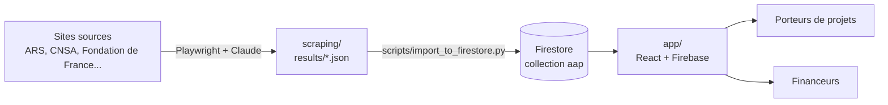

# AAP Santé — Contexte projet pour Claude Code

Fichier chargé automatiquement à chaque session Claude Code. Il remplace les anciens contextes
dispersés (CLAUDE.md du dossier scraping, PROJET-RESUME.md de l'application web),
fusionnés le 2026-10-09 dans ce dépôt unique.

---

## Qui / Quoi

- **Porteur** : Monsieur Pierre-Yves DUCOUT, fondateur de **ARCADIA SASU** (Évry, 91).
- **Projet** : **AAP Santé** — plateforme B2B SaaS d'agrégation et de matching IA d'appels à projets
  du secteur santé / médico-social français.
- **Cibles** : ~18 000 établissements (MCO, SSR, EHPAD, SSIAD, HAD, IME, ESAT…) côté porteurs ;
  financeurs publics/privés (ARS, CNSA, fondations, collectivités) côté AAP.
- **Phase actuelle** : reprise du projet (octobre 2026) — objectif : **obtenir une démo testable de bout en bout**
  (AAP scrapés visibles dans l'application).
- **Développement** : en solo par Monsieur DUCOUT dans Claude Code. Niveau : Python basique, pas expert.
  Toujours expliquer le POURQUOI avant le COMMENT.

---

## Style de réponse attendu

- **Français**, registre professionnel neutre.
- Nommer **« Monsieur DUCOUT »** et **« ARCADIA SASU »** dans les documents livrables.
- **Justifier chaque choix technique.**
- **Épistémie honnête** : si on ne sait pas, le dire. Marquer `[À VALIDER — Monsieur DUCOUT]` plutôt qu'inventer.
- **Pas d'emojis** dans les fichiers produits (code, .md, .txt). OK dans la conversation.
- Diagrammes **Mermaid** pour l'architecture et les flux.
- Références **RGPD** explicites quand pertinent (DPO = M. DUCOUT, AIPD reportée post-MVP).

---

## Architecture du dépôt (un seul endroit pour tout)

```
AAP/
├─ CLAUDE.md            <- ce fichier
├─ README.md            <- démarrage rapide (appli + scraping + import)
├─ docs/                <- cahiers des charges, comparatifs, anciens résumés (référence, pas de code)
├─ app/                 <- APPLICATION WEB : React 18 + TypeScript + Vite + Tailwind + Firebase
├─ scraping/            <- COLLECTE DES AAP : Python 3.12 + Playwright + Claude API (tool use)
├─ scripts/             <- JONCTION : import des JSON scrapés vers Firestore
└─ _archive/            <- prototypes abandonnés (crawl4ai, HTTrack). Ne pas réutiliser.
```



---

## DÉCISION DE STACK (2026-10-09) — à respecter

| Volet | Stack retenue | Pourquoi |
|---|---|---|
| Application web | **React 18 + Firebase (Auth, Firestore, Storage, Functions)** — dossier `app/` | Fonctionnelle, 8 phases du CDC réalisées, déjà déployée en test. C'est la voie la plus rapide vers une démo. |
| Scraping | **Python + Playwright + Claude API** — dossier `scraping/` | POC validé : 5 sources, ~105 AAP, ~0,03 €/AAP. |
| Jonction | **Script Python `firebase-admin`** — `scripts/` | Le plus simple pour alimenter Firestore depuis les JSON du scraping. |

**MISE EN PAUSE** : la cible FastAPI + PostgreSQL + Next.js décrite dans `docs/CDC_AAP_Sante_v1_2026-04.md`
(section stack) n'est **pas** la stack active. Ne pas la commencer sans décision explicite de Monsieur DUCOUT.
Le CDC v1 reste la référence **fonctionnelle** (schéma `AapNormalized`, principes de scraping, RGPD).

**ARCHIVÉ** : le prototype React 19 / Vite 7 / Tailwind v4 (service export CSV/Excel/PDF, 115 tests)
est conservé dans le tag Git `archive/export-v0` (ex-branche `claude/test-monitoring-code-5THZo`).
Son module `src/services/export.ts` pourra être porté dans `app/` quand l'export sera utile.

---

## Volet application web (`app/`)

- Projet Firebase : `aapi-11bc3` `[À VALIDER — Monsieur DUCOUT : projet toujours actif ?]`
- Déploiement de test : Netlify `https://teal-twilight-a7fcf3.netlify.app/` `[À VALIDER — encore en ligne ?]`
- Commandes : `cd app && npm install && npm run dev` (port 3000), `npm run build`, `npm run lint`
- Variables : `app/.env` (copier `app/.env.example`), jamais commité.
- Périmètre du MVP depuis le 2026-10-14 (lot 0 du rapport de critique) : routes `/`, `/login`, `/aap/search`,
  `/aap/:aapId`, `/admin`, `/admin/aaps`, `/admin/utilisateurs`, pages légales gabarit et 404 ; inscription fermée
  (`/signup` en 404) ; modules gelés jusqu'au lot 4 (liste dans `openspec/changes/lot-0-assainissement/design.md`),
  ne jamais les modifier. `npm run lint` (configuration créée le 2026-10-14, fichiers gelés ignorés), `npm run
  test:rules` (émulateur Firestore, JDK 21 en tête du PATH). `deadline` nullable et bloc `validation` dans le type `AAP`.
- Rôles : `porteur`, `financeur`, `admin` (champ `users/{uid}.userType`).
- Abonnement : essai 14 jours à l'inscription ; Stripe **non branché** (Cloud Functions non déployées).
- Détail complet (routes, collections Firestore, limites connues) : `docs/resume_application_web_2026-10.md`.

Contraintes UI fréquentes (source d'erreurs TypeScript) :
- `Button` : `variant` ∈ `primary | secondary | danger | ghost`
- `Badge` : `variant` ∈ `primary | success | warning | error | gray`
- `Stepper` : étapes `{ label, description }`

---

## Volet scraping (`scraping/`)

Principes non négociables (hérités du CDC v1 et validés par le POC) :
1. **Schéma unique `AapNormalized`** (`scraping/schema.py`) : toute source produit le même format.
2. **Claude tool use pour l'extraction** — pas de parser HTML par site.
3. **Signature de dédoublonnage** = `sha1(titre|financeur|date_cloture)[:16]`.
4. **Delta scraping** (cache inter-runs) pour contenir le coût API.
5. **Auto-healing IA** : l'IA propose un patch, un humain valide. Jamais de mise en prod automatique.
6. **Prompt caching** sur le system prompt ; **retry** sur 429/529/5xx.
7. **4 outils séparés** : `run.py` (JSON), `validate.py` (HTML), `analyze_costs.py` (texte), `debug_page.py` (navigateur visible). Ne pas les fusionner.

Conventions :
- 1 source = 1 fichier `scraping/sources/<nom>.py`, ~150 lignes max, deux fonctions obligatoires
  `async def list_aaps(page)` et `async def fetch_detail(page, url, downloads_dir)`.
- Modèle Anthropic : `claude-sonnet-4-6` (ne pas changer sans demande explicite).
- `load_dotenv(override=True)` dans `run.py` (fix Windows).
- **Règle d'ajout d'une source** : `python run.py --source <nom>` puis `python validate.py --source <nom>`,
  ouvrir le rapport HTML, et ne déclarer la source opérationnelle qu'après contrôle visuel.

Sources opérationnelles : `fondation_de_france` (64 AAP), `ars_idf` (18), `ars_idf_local` (18), `cnsa` (3), `ars_corse` (2).
**Registre des sources** : `scraping/sources/registre.json` (847 émetteurs, statut par source), outil
`scraping/registre.py`, vue `scraping/REGISTRE_SOURCES.md`. Toute nouvelle source part du registre.

---

## Volet jonction (`scripts/`)

- `scripts/import_to_firestore.py` : lit `scraping/results/*.json`, mappe `AapNormalized` vers le type `AAP`
  de l'application (`app/src/types/index.ts`), écrit dans la collection Firestore `aap` avec `source: "scraped"`.
- Identifiant du document = signature de dédoublonnage (ré-import idempotent).
- Nécessite une clé de compte de service Firebase (`scripts/serviceAccountKey.json`, **jamais commitée**).
- Environnement Python : `.venv` à la racine du dépôt (`scripts/requirements.txt`, `grpcio` fixé en 1.74.0 à cause
  de Smart App Control). `firebase-tools` installé en global pour déployer règles et index.

---

## État d'avancement (à maintenir à jour, dernière mise à jour 2026-10-12)

| Brique | État | Commentaire |
|---|---|---|
| Fusion en un dépôt unique | OK | 2026-10-09 |
| Appli web : phases 1 à 8 du CDC | OK | auth, profils, AAP, candidature, évaluation, messagerie, admin |
| Appli web : Cloud Functions | A FAIRE | écrites dans `app/functions/`, non déployées |
| Appli web : Stripe | A FAIRE | Price IDs à remplacer, functions à déployer |
| Appli web : tests | EN COURS | 2026-10-14 (lot 0) : tests des règles Firestore sur l'émulateur (`npm run test:rules`, JDK 21 requis, 13 verts) ; aucun test de rendu |
| Appli web : pages placeholder | A FAIRE | édition AAP, profil, pages légales, mot de passe oublié |
| Scraping : 5 sources | OK | voir ci-dessus |
| Scraping : registre des sources | EN COURS (annuaires) | 2026-10-09 : 847 sources ; 2026-10-13 (`registre-par-annuaires`) : familles adossées à des annuaires de référence avec taux de couverture (`REGISTRE_SOURCES.md`), vague 1 fondations du RNF terminée : 365 / 664 (54 %), 1 198 sources ; recherche des sites par Tavily (191) puis par la recherche web de la session (445 fondations : 165 sites inscrits, 271 sans site dont 62 hors champ non cherchées, 9 déjà au registre), 22 adresses à resonder ; agrégateur Fimeco Walter Allinial, 10 financeurs de la veille URIOPSS PACA-Corse et famille PLIE (annuaire fse.gouv.fr) ajoutés à sa demande |
| Scraping : découverte des rubriques AAP | OK | 2026-10-12 : 847 sources explorées, 270 rubriques candidates, 3 748 liens candidats (repérés par mots-clés, NON vérifiés : l'échantillon a montré 21 pages hors sujet sur 45) ; préfectures et ameli bloquent le robot (voir README scraping) |
| Scraping : qualification des sources | OK | 2026-10-12 : 270 rubriques relues par Ollama (sondage 83 % d'accord), puis relecture manuelle (changement `relecture-qualification`, `scraping/sources/relecture_qualification.json`) : 155 confirmées, 88 hors santé, 6 sans AAP, 20 à vérifier (`scraping/qualification.py`, `QUALIFICATION.md`, champ `qualification` du registre avec verdict du modèle conservé) |
| Scraping : extraction des AAP découverts | PASSAGE LOCAL TERMINÉ (2026-10-15, 7 h 40 : 2 178 textes, 1 086 fiches dont 2 à relire, 1 070 pages refusées, 22 échecs, 28,6 h de calcul, 0 euro ; classement du champ des 1 086 fiches par `claude-haiku-5-5` le 2026-10-15 à 8 h 50 sur son accord : santé 312, médico-social 209, hors champ 513, incertain 52, 0,23 euro réel pour 0,21 estimé, cumul Haiku 0,37 euro ; `scraping/CHAMP.md` : part dans le champ par source, ARS 93 à 100 %, collectivités 0 à 42 %) | `extraction-echantillon-aap` (archivé) : 24 fiches Claude Code justes, Ollama premier tour 9 justes sur 41 ; `extraction-ollama-second-tour` : mistral 7b 15 justes sur 23 et 13 fabriquées, qwen3:8b 16 sur 21 et 1 fabriquée, seuil 20/2 non atteint (`scraping/ECHANTILLON.md`). Décision 3.2 de Monsieur DUCOUT (2026-10-13 soir) : passage global au modèle local `qwen3:8b`, zéro euro, fiches « à vérifier » (changement `extraction-locale-globale`, `scraping/extraction_locale.py`, 2 395 adresses web uniques des 242 rubriques validées, 25 à 40 h de calcul par nuits, import par lots avec étiquette `a-verifier`) ; API estimée 99 euros pour 3 748 liens avant qualification ; 6 fiches de l'échantillon importées ; 2026-10-14 (lot 0, instruction 17) : mesure API `claude-haiku-5-5` sur les 45 textes de l'échantillon après accord (lecture par adresse ajoutée pour retrouver les 5 textes FIRAH écartés par la sélection par famille) : 21 fiches, 19 justes sur 20 comparées, 1 fabriquée, 4 pages de référence refusées à tort à la question fermée, seuil 20/2 manqué d'une fiche, coût réel 0,03 euro pour 66 appels ; comparaison local / Haiku sur 50 pages demandée par Monsieur DUCOUT, à cadrer après le lot 0 dans un changement dédié |
| Scraping : validation manuelle des pages et des liens | PAGES VALIDÉES ET REPORTÉES | 2026-10-13, changement `validation-manuelle-aap` : `scraping/validation.py` (modes pages / liens / fiches ; depuis le 2026-10-14 un seul raccourci sur le bureau, « Validation des fiches a verifier », les autres `.cmd` restent dans `scraping/`) ; 257 verdicts de Monsieur DUCOUT sur les pages (146 gardées + 111 exclues : 181 bonnes, 47 mauvaises avec adresse, 10 mortes, 18 hors champ) et 34 sur les liens. Changement `recherche-page-aap-par-source` : verdicts reportés au registre (`--appliquer-pages`, 242 rubriques confirmées, 18 hors santé), 50 adresses corrigées et redécouvertes (39 pages rafraîchies, 11 sans lien repéré) ; reste : 10 pages mortes à retrouver, 577 sources sans page, vérification 4.1 par Monsieur DUCOUT |
| Scraping : connecteur générique ARS (18 ARS) | A FAIRE | prochain changement ; collecte gratuite, extraction sur une ARS d'abord |
| Scraping : autres sources du registre | A FAIRE | une source ou famille par changement, dans l'ordre du registre |
| Jonction scraping -> Firestore | OK, RÈGLES DURCIES | 2026-10-09 : 89 AAP importés dans `aapi-11bc3` ; 2026-10-12 : + 6 fiches de l'échantillon ; 2026-10-14 (changement `organisation-donnees-validees`, audit `docs/AUDIT_DONNEES_2026-10-14.md`) : identifiant = adresse de l'appel (migration faite, 341 documents : 194 publiés dont 150 « à vérifier », 147 brouillons sans date), `status` / `publishedAt` / `validation` jamais réécrits, verdicts de `scraping/sources/verdicts_fiches.json` appliqués (rejetée -> archivé, validée -> badge retiré), fiches sans date en brouillon ; l'import global ignore `echantillon_*`, `controle_*`, `validation_*`, `*_non_aap` ; 2026-10-14 (lot 0, changement `lot-0-assainissement`) : `validation.statut` seule source de fiabilité (étiquette `a-verifier` dérivée, `par`), liste blanche des champs, `deadline` nulle pour les fiches sans date, cinq tests de l'audit sur un faux Firestore ; verdicts migrés dans `scraping/sources/` et règles Firestore déployées le 2026-10-14 après accord ; 141 échéances fictives passées à `null` par Monsieur DUCOUT le 2026-10-14 (`scripts/migrer_echeances.py`, sauvegarde dans `scripts/sauvegardes/`) ; mesure API (instruction 17) faite le 2026-10-14 après accord, 0,03 euro, seuil manqué d'une fiche (détail ligne « extraction des AAP découverts ») ; 2026-10-14 nuit (changement `filtre-champ-sante`, instruction 26) : champ de chaque fiche (`sante`, `medico-social`, `hors-champ`, `incertain`) classé par `claude-haiku-5-5` (connecteurs faits : 105 fiches, 34 hors champ, 0,03 euro ; passage local à classer après sa fin), fiche hors champ en brouillon à corriger, verdict « hors champ » (touche 7 de la validation quotidienne), fiches sans date publiées avec « Date de clôture non précisée » (décision du soir, remplace le brouillon du lot 0), migrations `scripts/migrer_champ.py` et `scripts/publier_sans_date.py` prêtes (essais à blanc : 10 publiées hors champ à repasser en brouillon, 120 brouillons sans date à publier) ; l'import ignore `comparaison_*` ; 2026-10-14, 22 h 50 : `migrer_champ.py` exécuté (10 fiches en brouillon, sauvegarde `champ_publiees_2026-10-14_2251.json`), décision de Monsieur DUCOUT ; changement `nettoyage-financeurs-territoires` codé (source réelle = émetteur du registre, financeur canonique `scraping/sources/financeurs.json`, territoire déduit `scraping/territoires.py`, plus de « france » par défaut, `scripts/doublons.py`) : essai à blanc 149 financeurs pour 390 publiées, 101 « france », 3 non précisés ; ré-import réel fait à 23 h 15 sur son accord : 449 documents, 415 publiées, 151 financeurs distincts (201 avant, 18 ARS à une entrée chacune), « france » 108 (234 avant), 3 non précisés, plus aucune source « extraction_locale » ; 5 groupes de doublons (10 fiches) listés par `scripts/doublons.py` ; 2026-10-15, 8 h 50 : ré-import après le classement du champ (« 120 crees, 409 mis a jour ») puis `migrer_champ.py` (147 fiches hors champ publiées repassées en brouillon, sauvegarde `champ_publiees_2026-10-15_0851.json`) : base 569 documents, 308 publiées (santé 172, médico-social 106, incertain 29, non classée 1, 131 sans date), 261 brouillons dont 258 hors champ |
| Démo bout en bout testable | OK | 2026-10-09 : AAP scrapés visibles dans « Rechercher des AAP », procédure README section 4 ; 2026-10-13 : consultation sans compte (changement `consultation-aap-sans-compte`, règle Firestore déployée), 95 AAP visibles sur http://localhost:3000/aap/search ; 2026-10-14 (lot 0) : routage réduit au MVP, `/signup` en 404, lint et build verts, `/aap/search` vérifié (194 AAP) ; 2026-10-14 soir : import réel et publication des fiches sans date, 420 AAP visibles ; filtres Territoire, Thématique (champ santé / médico-social) et Financeur fondés sur les valeurs réelles des fiches (changement `filtres-recherche`, vérifié : Normandie 15, Médico-social 5) ; 2026-10-14 nuit : filtre Source (site d'origine) et financeur canonique (changement `nettoyage-financeurs-territoires`, lint et build verts, écran vérifié après le ré-import : 415 AAP, 151 financeurs dont les 18 ARS à une entrée chacune, 91 sources, « Territoire non précisé ») |
| Pièces jointes des AAP scrapés | OK (local) | 2026-10-09 : servies depuis le PC en dev (`app/public/documents`) ; Storage codé, inactif (forfait Blaze refusé pour l'instant) |
| Méthode OpenSpec installée | OK | 2026-10-09 — 8 workflows, config projet |

---

## Ce qu'il NE faut PAS faire sans validation explicite

- Changer le schéma `AapNormalized` (impact toutes les sources) ou le type `AAP` de l'appli.
- Démarrer la stack FastAPI/PostgreSQL/Next.js (mise en pause).
- Installer une lib lourde (ex : Crawl4AI — rejetée, voir `docs/comparatif_scraping_2026-04.md`).
- Proposer un modèle IA local pour le MVP (décision d'avril : Claude API jusqu'à > 500 €/mois). Nuance du 2026-10-13,
  décidée par Monsieur DUCOUT : avant tout appel payant, un second tour d'extraction Ollama à zéro euro est mesuré contre
  les 24 fiches de référence de l'échantillon, avec un seuil fixé à l'avance ; l'API n'est retenue que si le seuil n'est
  pas atteint.
- Modifier un cahier des charges dans `docs/` sans en informer explicitement.
- Committer une clé (Anthropic, Firebase, Stripe). Tout est dans des `.env` ignorés par Git.
- Supprimer la branche ou le tag d'archive.

---

## Preuve avant affirmation (règle de travail, décidée par Monsieur DUCOUT le 2026-10-13)

Pourquoi : la session du 2026-10-13 a produit des affirmations fausses (« la découverte garde de mauvaises
pages ») corrigées après coup, et un outil construit « en essai » hors OpenSpec, sans scénario rejouable.
Monsieur DUCOUT préfère une contradiction immédiate à une correction deux jours plus tard.

1. Toute phrase sur l'état du projet vient d'un fichier ou d'une commande exécutés dans la session, source
   nommée ; sinon écrire « non vérifié ».
2. Quand Monsieur DUCOUT pose un diagnostic, le contrôler dans les données avant d'acquiescer, et le
   contredire si les données le disent.
3. Aucun statut (feuille de route, tableau d'avancement) ne change sans la commande qui le prouve, résultat
   collé dans le compte rendu.
4. Pas d'outil hors OpenSpec, même « en essai » : scénarios WHEN / THEN avant le code, rejoués par la session
   avec preuve visible avant de dire « ça marche », puis par Monsieur DUCOUT.
5. Une modification à la fois : la faire, la prouver, la faire valider, puis la suivante.
6. Chaque compte rendu finit par deux lignes : « Vérifié : ... » et « Non vérifié ou supposé : ... ».

---

## Méthode de développement : OpenSpec (spec-driven) — depuis 2026-10-09

Toute nouvelle fonctionnalité passe par un **changement OpenSpec** avant d'écrire du code.
Pourquoi : les sessions précédentes produisaient du code déclaré « fonctionnel » sans critère
vérifiable par Monsieur DUCOUT. Les scénarios WHEN / THEN de la spec sont ce critère.

Cycle (commandes slash dans Claude Code) :

| Commande | Effet |
|---|---|
| `/opsx:explore` | Comprendre le problème et le code existant, sans rien écrire |
| `/opsx:propose "<idée>"` | Crée `openspec/changes/<nom>/` : `proposal.md`, `specs/`, `design.md`, `tasks.md` |
| `/opsx:apply` | Implémente les tâches, une par une |
| `/opsx:verify` | Rejoue chaque scénario WHEN / THEN : OK ou ÉCHEC |
| `/opsx:archive` | Range le changement dans `changes/archive/` et fusionne dans `openspec/specs/` |

- `openspec/specs/` = la vérité fonctionnelle du produit (remplace progressivement les CDC de `docs/`,
  qui restent la référence historique).
- Règles d'écriture des artefacts : `openspec/config.yaml` (français, pas d'emojis, coût estimé, etc.).
- Prérequis : CLI `openspec` installé sur le poste (`npm install -g @fission-ai/openspec@latest`, Node >= 20.19).
- Changements archivés : `demo-aap-scrapes-visibles`, `pieces-jointes-aap`, `registre-des-sources`, `registre-des-sources-2`
  (2026-10-09), `decouverte-rubriques-aap`, `qualification-des-sources`, `relecture-qualification` (2026-10-12), `extraction-echantillon-aap`, `consultation-aap-sans-compte` (2026-10-13),
  `nettoyage-financeurs-territoires` (2026-10-14, validé par Monsieur DUCOUT : quatre exigences ajoutées à la spec
  `import-aap-scrapes`, source réelle, financeur canonique, territoire déduit, rapport des doublons).
  En cours : `lot-0-assainissement` (2026-10-14 : instructions 1 à 9 et 17 faites et commitées, vérification 8.1 de
  Monsieur DUCOUT en attente), `comparaison-moteurs-50-pages` (2026-10-14 : outil `scraping/comparaison.py` écrit et
  testé ; premier tirage de collectivités jugé et rapporté, second tirage chez les financeurs de la santé arrêté le
  2026-10-14 au soir sur décision de Monsieur DUCOUT, carte graphique rendue au passage global),
  `filtre-champ-sante` (2026-10-14 nuit, instruction 26 validée : définition du champ décidée, `scraping/champ.py`,
  règles d'import et touche 7 faites, classification des connecteurs puis, le 2026-10-15, du passage local faite par
  Haiku (0,26 euro en tout), import réel, publication des fiches sans date, `migrer_champ.py` (10 puis 147 fiches) et
  `CHAMP.md` faits ; restent la question du champ dans la chaîne d'extraction (5.1), la documentation (6) et la
  vérification de Monsieur DUCOUT (7)),
  `filtres-recherche` (2026-10-14 soir : filtres de `/aap/search` par territoire, thématique et financeur, faits et
  vérifiés, documentation et vérification de Monsieur DUCOUT en attente), `extraction-ollama-second-tour` (tours faits, décision 3.2 prise le 2026-10-13 soir : modèle local, à archiver),
  `extraction-locale-globale` (2026-10-13 soir : outil, import et badge faits, collecte finie, extraction en tâche de fond),
  `organisation-donnees-validees` (2026-10-14 : tâches 1 à 4 faites, vérification 5.1 de Monsieur DUCOUT en attente),
  `validation-manuelle-aap` (outil spécifié et rejoué, vérification 2.1 de Monsieur DUCOUT en attente) ; brouillon
  `recherche-page-aap-par-source` (2026-10-13 nuit : design, specs, tasks 1.1 à 2.1 faites, verdicts reportés, 3.1 et 4.1 en attente) ; `registre-par-annuaires` (2026-10-13, décision « 664 fondations du RNF »
  prise, inventaire des familles à valider, extrait RNF produit). Specs en vigueur :
  `import-aap-scrapes`, `consultation-aap-scrapes`, `registre-sources`, `decouverte-rubriques-aap`, `qualification-sources`.
- Reprise d'une session : lire d'abord `REPRISE.md` (racine) et `docs/FEUILLE_DE_ROUTE.md` (huit grandes étapes, état), puis `openspec/changes/*/tasks.md` (cases cochées = fait), `scraping/DECOUVERTE.md`,
  `scraping/QUALIFICATION.md` (section « Relecture manuelle » : corrections humaines des verdicts du modèle). Ouvrir la session dans CE dossier (AAP), jamais dans Scrapling.
- Modèle local Ollama (mistral:7b-instruct, installé sur le PC) : utilisé seulement comme outil de tri et de test à
  coût zéro (qualification, échantillon) ; la décision « Claude API pour le MVP » n'est pas remise en cause.
- Décision de Monsieur DUCOUT (2026-10-09) : tout tester en local avant de déployer ; pas de forfait Blaze
  (facturation) pour l'instant.

---

## Outillage Claude Code

- Hooks utilisateur (`.claude/settings.json`) : `session_start.py` (contexte au démarrage) et
  `detect_session_end.py` (déclenche le skill code-tracker). Fichiers dans `C:/Users/pierr/.claude/hooks/`.
  `[À VALIDER — session_start.py pointe-t-il encore vers le bon dossier après le déménagement ?]`
- Skill `code-tracker` : bilan de fin de session, CHANGELOG, commits.
- Comptes rendus de session : `.claude/sessions/` (local, non versionné).

---

## Références externes

- Dépôt : https://github.com/ducoutpy-lgtm/AAP
- Console Anthropic : https://console.anthropic.com/
- Console Firebase : https://console.firebase.google.com/project/aapi-11bc3
- Fondation de France (source POC) : https://www.fondationdefrance.org/fr/appels-a-projets
