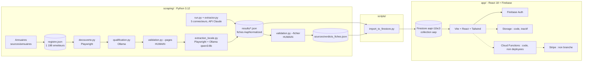
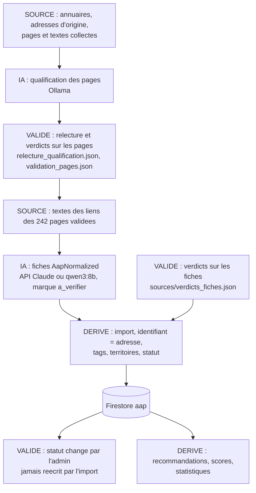

# Cahier des charges — AAP Santé

Document établi le 2026-10-14 à partir du code, de la configuration et de la documentation du dépôt
`AAP` (ARCADIA SASU, Monsieur Pierre-Yves DUCOUT). Il décrit l'application telle qu'elle existe, pas telle
qu'elle est souhaitée. Les cahiers des charges d'origine (`docs/CDC_AAP_Sante_v1_2026-04.md`,
`docs/CDC_application_web_v1.0_2025-11.md`) restent la référence historique ; les spécifications
fonctionnelles en vigueur sont dans `openspec/specs/`. Mention « À confirmer » = non vérifié dans le code
ou dépendant d'un test non fait. Version jumelle lisible par machine : `docs/application_spec.json`.

## 1. Résumé exécutif

AAP Santé est une plateforme B2B d'agrégation d'appels à projets (AAP) du secteur santé et médico-social
français. Elle collecte les appels publiés par des centaines d'émetteurs (agences régionales de santé,
CNSA, fondations, collectivités, ministères), les met au même format, les rend consultables dans une
application web, et permet à des porteurs de projets (établissements, associations) de candidater, et à des
financeurs de publier leurs propres appels et d'évaluer les candidatures. Le problème résolu : les appels
sont dispersés sur des centaines de sites, dans des formats hétérogènes, et aucun annuaire ne les réunit.
La chaîne de collecte combine des robots (navigateur piloté), de l'IA (API Claude pour cinq connecteurs
historiques, modèle local Ollama pour le passage en cours) et des validations humaines par Monsieur DUCOUT,
qui est le seul utilisateur réel à ce jour. L'application est en phase de démonstration locale : 341 appels
en base, pas d'utilisateur externe, paiement non branché.

## 2. Objectifs fonctionnels

Fonctionnalités principales (en place) :
- Constituer et maintenir un registre des émetteurs d'appels (1 198 entrées) adossé à des annuaires de référence.
- Trouver, pour chaque émetteur, la page qui liste ses appels, et la faire valider par un humain.
- Collecter le texte des pages d'appels et en extraire une fiche structurée (titre, financeur, dates,
  montants, description, éligibilité, pièces attendues, territoire, types d'établissement).
- Importer ces fiches dans la base de l'application sans doublon, en protégeant les décisions humaines.
- Consulter et rechercher les appels sans compte ; consulter une fiche avec ses pièces jointes.
- Marquer « À vérifier » les fiches produites par le modèle local ; permettre à un humain de les juger.

Fonctionnalités secondaires (codées, non testées ou partiellement fonctionnelles) :
- Comptes porteur, financeur, administrateur ; profils ; essai de 14 jours ; abonnement Stripe.
- Candidature en ligne à un appel, évaluation par le financeur, score de préqualification automatique.
- Recommandations d'appels à un porteur (score côté client), recherches sauvegardées avec alertes.
- Messagerie, notifications, calendrier, statistiques, administration des utilisateurs et des appels.

## 3. Utilisateurs et rôles

Source : `app/src/types/index.ts` (`UserType`), `app/src/App.tsx` (gardes), `app/firestore.rules`.

| Rôle | Qui | Accès et actions |
|---|---|---|
| Visiteur (sans compte) | Tout public | Recherche des appels publiés (`/aap/search`) et fiche d'un appel (`/aap/:aapId`), depuis le changement `consultation-aap-sans-compte`. |
| `porteur` | Établissement ou association qui cherche des financements | Tableau de bord, candidature à un appel, suivi de ses candidatures, recherches sauvegardées, recommandations, calendrier, messages, notifications. Exige un compte, un profil complété et un abonnement `active` ou `trial`. |
| `financeur` | Organisme qui publie des appels | Tableau de bord, création et liste de ses appels, consultation et évaluation des candidatures reçues, statistiques. Mêmes exigences d'abonnement. La page de modification d'un appel est un gabarit vide. |
| `admin` | Monsieur DUCOUT | Tableau de bord global, gestion des utilisateurs (suspendre, activer), gestion des appels (publier, clôturer, archiver, supprimer), statistiques globales. Pas de contrainte d'abonnement. Les pages paiements et paramètres sont des gabarits vides. |
| Opérateur de la chaîne de collecte | Monsieur DUCOUT, hors application | Lance les outils Python, valide pages et fiches dans un navigateur local (serveur `scraping/validation.py`), importe dans Firestore. |

Gardes de route : `ProtectedRoute` (connecté), `SubscriptionGuard` (statut `active` ou `trial`, sans
contrôle de la date de fin d'essai), `RoleGuard` (profil complété et rôle attendu).

## 4. Architecture générale

- Frontend : React 18, TypeScript, Vite 5, Tailwind 3, react-router 6, react-query, react-hook-form, zod,
  recharts ; `app/src`. Déploiement de test Netlify (à confirmer, lien dans `CLAUDE.md`).
- Backend : aucun serveur propre. Firebase Auth (e-mail et mot de passe, Google), Firestore (base de
  données documentaire, projet `aapi-11bc3`), Storage (codé, inactif faute de forfait Blaze), Cloud
  Functions (`app/functions/src/index.ts`, Node 18, région europe-west1, non déployées).
- Collecte : scripts Python dans `scraping/`, navigateur Playwright, API Anthropic (`claude-sonnet-4-6`)
  pour les cinq connecteurs historiques, serveur Ollama local (`http://localhost:11434`) pour la
  qualification et l'extraction en cours, recherche web (Tavily, puis la recherche de la session Claude Code).
- Jonction : `scripts/import_to_firestore.py` (firebase-admin) et `scripts/migrer_identifiants.py`.
- Automatisations : une fonction planifiée (`sendDailyAlerts`, 9 h Europe/Paris) non déployée ; aucun
  planificateur côté collecte (lancements manuels, parfois en tâche de fond de la session).
- Méthode : chaque évolution passe par un changement OpenSpec (`openspec/changes/`, specs dans
  `openspec/specs/`), règle « Preuve avant affirmation » (`CLAUDE.md`).

## 5. Objets métier

### 5.1 Émetteur (source du registre)

- Rôle : organisme susceptible de publier des appels. Fichier `scraping/sources/registre.json` (liste de 1 198 objets).
- Champs : `id` (slug unique), `nom`, `categorie` (ars, ministere, caisse-nationale, agence-nationale,
  fondation, europe, collectivite, societe-savante, etablissement, centrale-achat, autre), `url_aap`
  (adresse d'origine de la page des appels), `url_validee`, `validee_par`, `validee_le` (adresse donnée par
  Monsieur DUCOUT à l'écran, depuis le 2026-10-14), `perimetre`, `statut` (opérationnelle, identifiée...),
  `connecteur` (nom du connecteur Python, vide sinon), `notes`, `derniere_verification`, `code_http`,
  `qualification` {`verdict`, `date`, `justification`, `verdict_modele`, `relecture`}.
- Relations : une entrée par émetteur ; les pages découvertes et textes sont rangés sous `decouverte/<id>/`.
- Statuts de qualification : `rubrique-confirmee`, `hors-sante`, `pas-d-aap`, `pdf-seulement`, `a-verifier`.
- Règles : `registre.py --verifier-format` impose les champs et formats ; les outils lisent l'adresse par
  `registre.adresse_aap()` (`url_validee` sinon `url_aap`) ; seul `validation.py --appliquer-pages` écrit
  `url_validee` ; la relecture humaine de la qualification (`sources/relecture_qualification.json`) s'applique
  par-dessus le verdict du modèle et conserve `verdict_modele` et `relecture_precedente`.

### 5.2 Page d'appels et liens (découverte)

- Rôle : la page d'un émetteur qui liste ses appels, et les liens d'appels repérés dessus.
- Fichiers : `scraping/decouverte/resultats.json` (par `id` : `statut` rubrique-trouvee / aucune-rubrique /
  erreur, `url_depart`, `url_rubrique`, `nb_liens_aap`, `candidats_visites`, `date`), `decouverte/<id>/rubrique.html`,
  `decouverte/<id>/liens.json` (`texte`, `href`, `score`), `decouverte/<id>/fiches/<sha1 10>.txt` (texte lisible
  d'un lien, adresse en première ligne). Dossier hors Git, régénérable.
- Validation humaine : `results/validation_pages.json` (clé = adresse de la page, verdicts `bonne-page`,
  `mauvaise-page` avec adresse en commentaire, `page-morte`, `hors-champ`, `passer`) ; reportée au registre
  par `validation.py --appliquer-pages`.

### 5.3 Fiche d'appel (AapNormalized)

- Rôle : un appel à projets structuré, format unique de toute la collecte. Classe Pydantic
  `scraping/schema.py` : `titre`, `financeur`, `description`, `url_source` (obligatoires) ; `date_ouverture`,
  `date_cloture` (texte ISO AAAA-MM-JJ ou null), `montant_min`, `montant_max` (entiers), `enveloppe_globale`
  (texte), `eligibilite[]`, `pieces_attendues[]`, `territoire`, `categories_etablissement[]`,
  `fichiers_joints[]` {`url`, `filename`, `local_path`}, `scrape_metadata` (dictionnaire libre).
- `scrape_metadata` des connecteurs : `scraped_at`, `last_seen_at`, `source`, `signature`. Du modèle local :
  `source` (id du registre), `moteur` (`ollama`), `modele` (`qwen3:8b`), `duree_s`, `fichier`, `a_relire`,
  `ecarts`, `a_verifier` (true), `produite_le`, `version_consigne` (ces deux derniers depuis le 2026-10-14).
- Fichiers : `scraping/results/<connecteur>.json` (fondation_de_france, ars_idf, ars_idf_local, cnsa,
  ars_corse), `results/extraction_locale.json`, `results/echantillon_*.json` (essais, hors import global),
  `results/*_non_aap.json` (pages refusées), `*.errors.json`.
- Validation humaine : `scraping/sources/verdicts_fiches.json` (clé = `url_source`, `verdict` parmi
  `aap-juste`, `aap-a-corriger`, `pas-un-aap`, `passer`, `commentaire`, `date`). Versionné.

### 5.4 AAP (document Firestore, collection `aap`)

- Rôle : l'appel tel que l'application l'affiche. Type `AAP` dans `app/src/types/index.ts`.
- Champs : `financeurId` (`"scraped"` pour les imports), `financeurName`, `title`, `description`,
  `sectorsTargeted[]`, `territoriesEligible[]`, `structureTypeEligible[]`, `budgetMin`, `budgetMax`,
  `budgetTotal`, `deadline` (obligatoire), `publicationDate`, `startDate`, `endDate`, `eligibilityCriteria`,
  `evaluationCriteria`, `requiredDocuments[]`, `externalUrl`, `contactEmail`, `contactPhone`, `tags[]`,
  `status`, `publishedAt`, `createdAt`, `updatedAt`, `views`, `applicationsCount`, `source` (`manual` |
  `scraped`), `scrapeMetadata` {`source`, `signature`, `moteur`, `modele`, `enveloppeGlobale`,
  `fichiersJoints[]`, `importedAt`}, `validation` {`statut`, `commentaire`, `date`} (écrit par l'import,
  absent du type TypeScript : à ajouter).
- Identifiant : `scraped-<sha1(url_source normalisée)[:16]>` pour les imports (depuis le 2026-10-14) ;
  identifiant Firestore automatique pour les appels saisis par un financeur.
- Statuts : `AapStatus` = `draft` | `published` | `closed` | `archived` ; `validation.statut` = `proposee` |
  `a_corriger` | `validee` | `rejetee`.
- Étiquettes de provenance dans `tags` : nom du fichier source, `a-verifier` (modèle local non relu),
  `sans-date-cloture`, territoire et catégories bruts.
- Relations : `applications.aapId`, `favoriteAap.aapId`, notifications `relatedEntityId`.

### 5.5 Utilisateur et profils

- `users/{uid}` (type `User`) : `email`, `userType`, `subscriptionStatus` (`active` | `trial` | `expired` |
  `cancelled`), `subscriptionPlan` (`monthly` | `annual` | null), `subscriptionId`, `stripeCustomerId`,
  `profileComplete`, `trialEndsAt`, `currentPeriodEnd`, `notificationPreferences`, `createdAt`.
- `porteurProfiles/{uid}` : `structureName`, `siret`, `structureType` (entreprise, association,
  collectivite, laboratoire, autre), `secteurActivite`, `domainesIntervention[]`, `address`, `contactPerson`,
  `teamSize`, `website`, `description`.
- `financeurProfiles/{uid}` : `organisationName`, `organisationType` (ministere, agence, fondation,
  entreprise, collectivite), `sectorsSupported[]`, `address`, `contactPerson`, `website`, `logo`, `description`.

### 5.6 Candidature (collection `applications`)

- Type `Application` : `aapId`, `porteurId`, `financeurId`, `projectTitle`, `projectDescription`,
  `objectives`, `methodology`, `timeline`, `expectedImpact`, `budget` {`total`, `breakdown[]`}, `team[]`,
  `partners[]`, `documents[]`, scores automatiques (`prequalificationScore`, `completenessScore`,
  `conformityScore`, `qualityScore`, `conformityFlags[]`, `suggestions[]`), évaluation (`financeurScore`,
  `financeurNotes`, `financeurComments`), `status`, `statusHistory[]`, dates.
- Statuts `ApplicationStatus` : `draft` | `submitted` | `under_review` | `accepted` | `rejected` | `pending_info`.
- Règles : créée par un porteur avec abonnement ; modifiable par le porteur en `draft`, par le financeur
  ensuite ; la fonction `onApplicationCreated` (non déployée) calcule le score et notifie.

### 5.7 Objets secondaires

`savedSearches` (type `SavedSearch`, filtres et alerte), `favoriteAap` (non utilisé par l'interface),
`notifications` (type `Notification`, types `system`, `new_aap`, `deadline`, `status_change`, `new_message`),
`messages` et `conversations` (messagerie, incohérente : voir section 12), `payments` (écrits par le
webhook Stripe), `analytics` (lecture admin, jamais écrit).

## 6. Cycle de vie des données

Quatre catégories, telles qu'elles sont séparées aujourd'hui (audit `docs/AUDIT_DONNEES_2026-10-14.md`,
schéma détaillé `docs/FLUX_DONNEES.md`) :

| Catégorie | Contenu | Emplacement | Qui écrit |
|---|---|---|---|
| Source (brut) | Annuaires d'émetteurs, adresses d'origine (`url_aap`), pages HTML gardées, textes collectés, liens repérés | `sources/annuaires/`, `registre.json` (`url_aap`), `decouverte/` | Annuaires, robots |
| Proposition IA | Verdict de qualification du modèle, fiches extraites (connecteurs et modèle local), pages refusées | `decouverte/qualification.json`, `results/*.json` | API Claude, Ollama |
| Validé (humain) | Relecture de la qualification, verdicts sur les pages, liens et fiches, adresse validée, statut de publication et bloc `validation` dans Firestore | `sources/relecture_qualification.json`, `results/validation_pages.json`, `results/validation_liens.json`, `sources/verdicts_fiches.json`, `registre.json` (`url_validee`), Firestore `status` / `validation` | Monsieur DUCOUT, écrans d'administration |
| Dérivé | Rapports Markdown (`REGISTRE_SOURCES.md`, `DECOUVERTE.md`, `QUALIFICATION.md`, `ECHANTILLON.md`), étiquettes et champs calculés à l'import (`tags`, `territoriesEligible`, `sectorsTargeted`, `budgetTotal`), scores de candidature, recommandations | fichiers générés, Firestore, calcul côté client | Scripts, fonctions, navigateur |

Règles de protection en vigueur (depuis le 2026-10-14) : sur un document existant, l'import ne réécrit
jamais `status`, `publishedAt` ni `validation` ; si `validation.statut` vaut `validee`, les champs métier
ne sont plus réécrits non plus ; `rejetee` archive ; une fiche sans date de clôture entre en `draft` avec
`validation.statut = a_corriger`.

## 7. Workflows

### 7.1 Constitution du registre des émetteurs

- Déclencheur : décision de couvrir une famille d'émetteurs (`sources/annuaires/familles.json`).
- Étapes : extraction de l'annuaire (`annuaires.py`, ex. 664 fondations du Registre national des fondations),
  recherche du site de chaque organisme (Tavily puis recherche web de la session), sonde HTTP (code 200 et
  mot du nom dans la page), intégration (`--integrer`), rapport (`registre.py --tableau` -> `REGISTRE_SOURCES.md`).
- Acteurs : session Claude Code ; Monsieur DUCOUT décide des familles et vagues.
- Données : `sources/annuaires/*.csv`, `results/recherche_sites.jsonl` (journal), `registre.json`.
- Erreurs : site introuvable (« incertain »), doublons par nom (rapprochement manuel), sonde en échec.
- Résultat : entrées `statut: identifiee`, `qualification: a-verifier`.

### 7.2 Découverte, qualification et validation des pages

- Déclencheur : nouvelles entrées au registre ou adresse corrigée.
- Étapes : `decouverte.py` (ouvre `adresse_aap`, visite des candidats par mots-clés, garde la page la plus
  riche en liens d'appels, option `--garder-depart` pour garder l'adresse donnée) ; `qualification.py
  --qualifier` (question fermée au modèle local sur le texte de la page) ; relecture humaine
  (`relecture_qualification.json`) ; validation à l'écran (`validation_pages.cmd`, `validation_exclues.cmd`) ;
  report (`validation.py --appliquer-pages`) ; `qualification.py --registre --rapport`.
- Statuts traversés : découverte `rubrique-trouvee` / `aucune-rubrique` / `erreur` ; qualification
  `a-verifier` -> verdict du modèle -> verdict relu.
- Erreurs : sites qui bloquent le robot (préfectures, ameli, Cloudflare), délai de 180 s dépassé, page
  d'accueil ou bandeau cookies jugés à la place de la rubrique.
- Résultat : 242 émetteurs en `rubrique-confirmee` au 2026-10-13.

### 7.3 Extraction des fiches par le modèle local (en cours)

- Déclencheur : décision du 2026-10-13 (changement `extraction-locale-globale`).
- Étapes : `extraction_locale.py --collecter` (texte de chaque lien web des 242 pages, une adresse une
  fois, fichiers PDF exclus ; 2 178 textes) ; `--extraire --modele qwen3:8b` (question fermée « est-ce la
  fiche d'un appel ? », extraction JSON contrainte, contrôle des formats avec seconde demande puis null et
  marque `a_relire`) ; `--bilan` ; import par lots.
- Acteurs : session ; Monsieur DUCOUT juge ensuite les fiches (`validation_fiches.cmd`, fiches ouvertes).
- Données : `decouverte/<id>/fiches/*.txt`, `results/extraction_locale.json`, `_non_aap.json`, `.errors.json`.
- Erreurs : délai Ollama 600 s dépassé (échec), pages bloquées refusées, arrêt du PC (reprise automatique).
- Résultat au 2026-10-14 12 h 30 : 567 fiches, 478 refus, 17 échecs, 1 116 textes restants.

### 7.4 Collecte par connecteur (API Claude, cinq sources historiques)

- Déclencheur : `python run.py --source <nom>` (manuel).
- Étapes : `sources/<nom>.py` (`list_aaps`, `fetch_detail` avec Playwright) ; `orchestrator.py` (cache par
  `url_source` du run précédent, signature) ; `extractor.py` (Claude tool use, prompt caching, retry 429/529/5xx,
  journal des coûts `logs/extraction_costs.jsonl`) ; `validate.py` (rapport HTML pour contrôle visuel).
- Résultat : `results/<nom>.json`, pièces jointes dans `downloads/`.

### 7.5 Import dans l'application

- Déclencheur : manuel, après un lot d'extraction ou un verdict.
- Étapes : lecture de `results/*.json` (hors `echantillon_*`, `controle_*`, `validation_*`, `*_non_aap`),
  lecture de `sources/verdicts_fiches.json`, mappage vers le type `AAP` (`to_app_aap`), fiche sans date ->
  brouillon, verdict appliqué (`appliquer_verdict`), identifiant par adresse (`identifiant`), fusion des
  doublons (connecteur prioritaire sur modèle local), écriture par lots de 400 (`document_a_envoyer`).
- Options : `--dry-run`, `--source <fichier>`, `--include-expired`, `--vers-storage` (inactif sans Blaze).
- Résultat : collection `aap` ; au 2026-10-14 : 341 documents, 194 publiés dont 150 « À vérifier », 147 brouillons.

### 7.6 Validation humaine des fiches

- Déclencheur : raccourci bureau « Validation des fiches à vérifier » (`validation_fiches.cmd`, port 8789).
- Étapes : serveur local, une fiche à la fois (champs, extrait du texte, page officielle dans une fenêtre),
  boutons juste / à corriger / pas un appel / passer ; verdict écrit immédiatement dans
  `sources/verdicts_fiches.json` ; prise en compte au prochain import.
- Résultat : badge retiré, fiche archivée, ou commentaire porté.

### 7.7 Parcours d'un porteur dans l'application

- Inscription (`/signup`, e-mail et mot de passe, e-mail de vérification) -> document `users` en `trial`
  (`trialEndsAt` J+14) -> `/complete-profile` -> `/abonnement/choisir` (Stripe non fonctionnel ; lien
  « continuer avec l'essai ») -> `/dashboard/porteur` -> recherche -> fiche -> `/aap/:id/candidater`
  (formulaire multi-étapes, créé directement en `submitted`) -> `/mes-candidatures`.
- Erreurs connues : connexion Google sans document `users` (profil nul), favoris sans action, création de
  recherche sauvegardée probablement refusée par les règles (voir section 12).

### 7.8 Parcours d'un financeur et de l'administrateur

- Financeur : `/aap/nouveau` (création, statut `draft` puis publication), `/mes-aap`, `/aap/:id/candidatures`,
  évaluation (`status`, `financeurScore`, commentaires), `/statistiques`.
- Administrateur : `/admin/aaps` (publier, clôturer, archiver, supprimer), `/admin/utilisateurs`
  (suspendre = `subscriptionStatus: cancelled`, activer = `active`). Les règles Firestore refusent
  probablement ces écritures (à confirmer, section 12).

## 8. Modèle de données

### 8.1 Firestore (projet `aapi-11bc3`)

| Collection | Champs principaux | Contraintes et règles d'accès | Index (`firestore.indexes.json`) | Traçabilité |
|---|---|---|---|---|
| `aap` | voir 5.4 | lecture publique si `status == published`, sinon abonné ; création financeur abonné ; modification et suppression par `financeurId == uid` ; import via compte de service | (status, publishedAt desc), (status, sectorsTargeted contains, publishedAt desc), (financeurId, createdAt desc) | `createdAt`, `updatedAt`, `publishedAt`, `scrapeMetadata.importedAt`, `validation.date` |
| `users` | voir 5.5 | lecture propriétaire ou admin ; création authentifié ; modification propriétaire | aucun | `createdAt` |
| `porteurProfiles`, `financeurProfiles` | voir 5.5 | propriétaire (admin en lecture) | aucun | `updatedAt` |
| `applications` | voir 5.6 | lecture porteur, financeur ou admin ; création porteur abonné ; modification porteur en `draft` ou financeur | (porteurId, createdAt), (financeurId, createdAt), (aapId, createdAt) | `createdAt`, `updatedAt`, `submittedAt`, `statusHistory[]` |
| `savedSearches`, `favoriteAap` | `userId`, filtres | lecture et écriture propriétaire (règle sur `resource.data`, défaillante à la création : à confirmer) | aucun | `createdAt`, `lastExecutedAt` |
| `notifications` | `userId`, `type`, `read`, `actionUrl` | lecture propriétaire ; écriture propriétaire ou admin | (userId, createdAt desc) | `createdAt` |
| `messages`, `conversations` | `applicationId` ou `conversationId`, `senderId`, `receiverId`, `content` | messages : expéditeur ou destinataire ; conversations : aucune règle | (applicationId, createdAt) | `createdAt` |
| `payments` | `userId`, `amount`, `currency`, `status`, période | lecture propriétaire ou admin ; écriture interdite (fonctions seulement) | (userId, paidAt desc) | `paidAt` |
| `analytics` | compteurs journaliers | lecture admin ; écriture interdite | aucun | `date` |

Index recommandés en plus (non créés) : `messages` (conversationId, createdAt) ; `conversations`
(participants contains, lastMessageAt) ; `aap` (status, validation.statut) si l'application filtre un jour
sur la validation.

### 8.2 Fichiers du volet collecte

| Fichier | Forme | Clé | Versionné |
|---|---|---|---|
| `scraping/sources/registre.json` | liste d'objets (5.1) | `id` | oui |
| `scraping/sources/annuaires/familles.json`, `*.csv` | inventaire des familles, extraits d'annuaires | nom de famille, ligne | oui |
| `scraping/sources/relecture_qualification.json` | objet `id -> {verdict, motif, date, relecteur, relecture_precedente}` | `id` | oui |
| `scraping/sources/verdicts_fiches.json` | objet `url -> {verdict, commentaire, date}` | `url_source` | oui |
| `scraping/decouverte/resultats.json`, `<id>/liens.json`, `<id>/fiches/*.txt`, `qualification.json` | voir 5.2 | `id`, adresse | non (régénérable) |
| `scraping/results/<connecteur>.json`, `extraction_locale.json` | liste de fiches AapNormalized | `url_source` | non |
| `scraping/results/validation_pages.json`, `validation_liens.json` | objet `url -> verdict` | adresse de la page ou du lien | non (à verser dans `sources/`, voir 12) |
| `scraping/logs/extraction_costs.jsonl` | une ligne par appel API (modèle, tokens, coût) | horodatage | non |

### 8.3 Traçabilité présente et manquante

Présente : dates et relecteur sur les verdicts ; `scraped_at` et `signature` sur les fiches des connecteurs ;
`moteur`, `modele`, `produite_le`, `version_consigne` sur les fiches du modèle local produites après le
2026-10-14 ; `importedAt`, `createdAt`, `updatedAt` dans Firestore. Manquante : nom du modèle sur les fiches
des connecteurs (seulement dans le journal des coûts) ; date de collecte dans les textes ; `validatedBy`
dans Firestore (le relecteur n'est pas reporté, seulement le statut, le commentaire et la date).

## 9. Règles métier

Règles explicites (code et `CLAUDE.md`) :
1. Un seul format de fiche, `AapNormalized` ; ne pas le modifier sans décision explicite.
2. Identifiant d'un appel importé = sha1 de l'adresse normalisée ; la signature (titre, financeur, clôture)
   reste un attribut et sert au cache des connecteurs.
3. L'import ignore par défaut les appels clos (`deadline < aujourd'hui`) ; `--include-expired` les importe.
4. Fiche sans date de clôture : brouillon, échéance fictive à un an, étiquette `sans-date-cloture`,
   validation « à corriger » ; jamais publiée sans décision humaine.
5. L'import ne réécrit jamais `status`, `publishedAt`, `validation` d'un document existant ; une fiche
   validée garde ses champs métier.
6. Verdict « pas un AAP » = archivé (pas supprimé) ; « AAP juste » = badge « À vérifier » retiré ;
   « à corriger » = badge gardé, commentaire porté.
7. Pour une même adresse, la fiche d'un connecteur l'emporte sur celle du modèle local.
8. Toute fiche produite par le modèle local porte `a_verifier` et l'étiquette `a-verifier` ; l'application
   affiche « À vérifier » (liste et fiche).
9. Un appel est lisible sans compte si `status == published` ; « Clôturé » affiché quand la date est passée.
10. Un compte reçoit un essai de 14 jours à l'inscription ; les gardes acceptent `active` ou `trial`.
11. Candidature : création réservée au porteur abonné ; modification par le porteur seulement en `draft`.
12. Registre : adresse de travail = `url_validee` sinon `url_aap` ; `url_validee` n'est écrite que par le report
    des verdicts humains ; format vérifié par `registre.py --verifier-format`.
13. Relecture humaine de la qualification : s'applique par-dessus le verdict du modèle, conserve
    `verdict_modele` ; un identifiant inconnu est ignoré avec avertissement ; un verdict hors liste arrête.
14. Modèle local : un seul travail Ollama à la fois ; pas d'appel payant à l'API sans accord ; modèle
    Anthropic `claude-sonnet-4-6` pour les connecteurs.
15. Méthode : pas d'outil hors changement OpenSpec ; chaque tâche cochée avec preuve ; chaque compte rendu
    finit par « Vérifié / Non vérifié ».

Règles implicites (constatées dans le code) :
- Les pièces jointes sont servies depuis le PC en développement (`app/public/documents` vers `scraping/downloads`).
- `sectorsTargeted` vaut toujours `["sante", "social"]` pour un import ; `territoriesEligible` vaut `["france"]`
  si le territoire n'est pas reconnu.
- Score de recommandation (client) : secteurs 40, territoire 30 ou 20, budget 20, délai 10 ou 5 ; seuil 50 ;
  10 résultats.
- Score de préqualification (fonction) : 100 moins 15 par champ vide, 10 si description courte, 15 sans
  budget, 10 sans équipe.

## 10. Intégrations et dépendances

| Composant | Technologie / service | Usage | Fichier |
|---|---|---|---|
| Base et authentification | Firebase (Auth, Firestore, Storage, Functions), projet `aapi-11bc3` | données de l'application | `app/src/config/firebase.ts`, `app/firebase.json` |
| Frontend | React 18.2, react-router 6.20, react-query 5, react-hook-form 7, zod 3, Tailwind 3, recharts 2, lucide-react, dompurify, date-fns | interface | `app/package.json` |
| Paiement | Stripe (stripe-js 2.2, stripe 14.9 côté fonctions) | abonnement, non branché | `app/src/config/stripe.ts`, `app/functions/src/index.ts` |
| Supervision | @sentry/react 7.91 | installé, jamais initialisé | `app/package.json` |
| Extraction IA payante | API Anthropic, `claude-sonnet-4-6`, SDK `anthropic` | connecteurs historiques | `scraping/extractor.py` |
| Extraction IA locale | Ollama 0.40 (API HTTP locale), modèles `qwen3:8b`, `mistral:7b-instruct`, `llama3.2:3b` | qualification, échantillon, passage global | `scraping/qualification.py`, `scraping/echantillon.py`, `scraping/extraction_locale.py` |
| Navigateur piloté | Playwright (Chromium) | découverte, collecte des textes, connecteurs | `scraping/decouverte.py`, `scraping/utils.py` |
| Recherche web | API Tavily (plan gratuit épuisé), recherche web de la session Claude Code | sites des émetteurs | `scraping/recherche_web.py`, `scraping/annuaires.py` |
| Jonction | firebase-admin 6, google-cloud-firestore, grpcio 1.74.0 (version fixée) | import | `scripts/import_to_firestore.py` |
| Validation humaine | serveur HTTP de la bibliothèque standard Python, `requests` | écrans de validation | `scraping/validation.py` |
| Méthode | CLI `openspec` 1.14 | changements et specs | `openspec/` |
| Dépôt | GitHub `ducoutpy-lgtm/AAP` | trace | |

Variables d'environnement (noms seulement) :
- `app/.env` : `VITE_FIREBASE_API_KEY`, `VITE_FIREBASE_AUTH_DOMAIN`, `VITE_FIREBASE_PROJECT_ID`,
  `VITE_FIREBASE_STORAGE_BUCKET`, `VITE_FIREBASE_MESSAGING_SENDER_ID`, `VITE_FIREBASE_APP_ID`,
  `VITE_STRIPE_PUBLIC_KEY`, `VITE_APP_ENV`, `VITE_APP_URL`, `VITE_SENTRY_DSN`, `VITE_USE_EMULATORS`
  (lue mais absente de `.env.example`).
- Fonctions : `stripe.secret_key`, `stripe.webhook_secret`, `app.url` (ou `STRIPE_SECRET_KEY`,
  `STRIPE_WEBHOOK_SECRET`, `VITE_APP_URL`).
- `scraping/.env` : `ANTHROPIC_API_KEY`, `TAVILY_API_KEY`.
- `scripts/serviceAccountKey.json` : clé de compte de service Firebase (fichier, ignoré par Git).
- Claude Code : `CLAUDE_CODE_MAX_WEB_SEARCHES_PER_SESSION` dans `.claude/settings.json`.

## 11. Sécurité et données sensibles

- Données personnelles : comptes (`users`, e-mail), profils (contact nominatif, SIRET, adresse),
  candidatures (équipe nominative, budget, documents), messages. DPO : Monsieur DUCOUT ; analyse d'impact
  (AIPD) reportée après le MVP (`CLAUDE.md`). Aucun utilisateur externe à ce jour.
- Les appels à projets sont des données publiques ; les fiches ne contiennent pas de données personnelles,
  sauf éventuels contacts d'organismes copiés depuis les pages.
- Contrôle d'accès : règles Firestore et Storage (section 8.1) ; gardes de route côté client (non suffisantes
  seules) ; compte de service pour l'import (droits complets, clé sur le poste).
- Secrets : tous dans des fichiers ignorés par Git (`app/.env`, `scraping/.env`, `serviceAccountKey.json`) ;
  vérification avant chaque commit ; aucune clé dans ce document ni dans `application_spec.json`.
- Points de vigilance : essai de 14 jours sans expiration effective ; règles de création de `savedSearches`,
  `favoriteAap`, `notifications` fondées sur `resource.data` (probablement bloquantes) ; actions admin non
  couvertes par les règles ; `conversations` sans règle ; Sentry non initialisé ; `alert()` natifs ;
  Storage inactif donc pièces jointes servies seulement en local ; robots de collecte à utiliser avec
  pause et depuis la box domestique (préfectures bloquent les centres de données).
- Bonnes pratiques à respecter : ne jamais afficher un secret dans la conversation ; essai à blanc avant
  toute écriture en base ; sauvegarde JSON avant toute migration (`scripts/sauvegardes/`, ignoré par Git) ;
  jamais de `git push` sans demande explicite.

## 12. Limites et dette technique

Collecte :
- Passage d'extraction local inachevé (1 116 textes restants au 2026-10-14) ; environ 1 fiche sur 4 à 5 avec un
  champ faux, d'où la marque « À vérifier » ; 533 liens vers des fichiers PDF, Word, Excel non traités.
- 577 émetteurs sans page validée, 10 pages mortes à retrouver, 22 adresses à resonder.
- Verdicts sur les pages indexés par l'adresse de la page (devient orpheline après redécouverte) ;
  `validation_pages.json` et `validation_liens.json` non versionnés (dans `results/`).
- Trois copies de l'échantillon (`echantillon_ollama*.json`, `echantillon_claude_code.json`,
  `echantillon_valides.json`) et une grille mêlant colonnes manuelles et automatiques.
- Connecteurs historiques sans nom de modèle dans la fiche ; textes collectés sans date.
- Doublons d'émetteurs dans le registre (même page sous deux identifiants : Île-de-France, Drôme).
- Adresse validée FIRAH pointant vers une page de la Fondation OCIRP (verdict humain du 2026-10-13, à revoir).
- Pas de veille des changements (étape 4 de la feuille de route) ; lancements manuels.

Jonction et base :
- 49 appels des connecteurs historiques sans date de clôture passés en brouillon par la règle du 2026-10-14
  (décision à confirmer : la règle visait les fiches du modèle local).
- Champ `validation` écrit dans Firestore mais absent du type `AAP` TypeScript ; pas de `validatedBy`.
- Blocs source / proposition / affichage non séparés dans le document (champs à plat) ; `tags` mêle provenance
  et contenu.

Application :
- Cloud Functions écrites mais non déployées (Blaze refusé) : pas de score de préqualification, pas de
  notification automatique, pas d'alerte quotidienne, pas de webhook Stripe.
- Stripe : Price IDs fictifs, `redirectToCheckout` déprécié (à confirmer), pas de portail client.
- Essai de 14 jours jamais expiré (aucune comparaison de `trialEndsAt`).
- Règles Firestore : création probablement refusée pour `savedSearches`, `favoriteAap`, `notifications`
  (`resource.data` au lieu de `request.resource.data`) ; actions admin sur `aap` et `users` non autorisées ;
  `conversations` sans règle (à confirmer par test avec l'émulateur).
- Incohérences de champs : formulaire de candidature écrit `teamMembers`, `partnersInvolved`,
  `riskManagement`, `sustainabilityPlan` au lieu de `team`, `partners` ; `SavedSearchesPage` écrit `frequency`
  au lieu de `alertFrequency` ; `EvaluateApplicationPage` utilise un statut `shortlisted` absent du type ;
  `RecommendationsPage` lit `profile.effectif` qui n'existe pas (`teamSize`), budget estimé toujours 50 000 euros.
- Candidature créée directement en `submitted`, jamais en `draft`.
- `sendDailyAlerts` ignore les filtres des recherches sauvegardées et la fréquence.
- Notifications avec liens vers des routes inexistantes (`/mes-candidatures/{id}`, `/mes-aap/{id}/candidatures/{id}`).
- Pages gabarit : `/aap/:id/edit`, `/profil`, `/admin/paiements`, `/admin/parametres`, pages légales, 404.
- Favoris non implémentés ; connexion Google sans document `users` ; aucun test automatisé côté application ;
  Sentry non initialisé ; recherche filtrée côté client après lecture de tous les appels publiés.
- Déploiement Netlify et activité du projet Firebase : à confirmer.

## 13. Glossaire

- AAP : appel à projets (aussi appel à candidatures, à manifestation d'intérêt, bourse, prix).
- Émetteur / source : organisme qui publie des appels ; une entrée du registre.
- Registre : `scraping/sources/registre.json`, liste des émetteurs avec statut et qualification.
- Annuaire : liste de référence externe d'une famille d'émetteurs (ex. Registre national des fondations).
- Page validée / rubrique confirmée : page d'un émetteur qui liste ses appels, jugée bonne par un humain.
- Découverte : robot qui trouve cette page et y repère les liens d'appels.
- Qualification : verdict (modèle puis humain) sur la page gardée : confirmée, hors santé, sans appel, à vérifier.
- Relecture : correction humaine d'un verdict du modèle, tracée avec motif et relecteur.
- Lien / adresse candidate : lien repéré par mots-clés sur une page validée.
- Texte collecté : texte lisible de la page d'un lien, enregistré par le navigateur.
- Extraction : production d'une fiche à partir d'un texte, par l'API Claude ou le modèle local.
- Fiche : un appel structuré au format `AapNormalized`.
- Page refusée : texte jugé « pas la fiche d'un appel » par le modèle.
- Connecteur : script Python par source (`scraping/sources/<nom>.py`) utilisant l'API Claude.
- Modèle local : modèle Ollama tournant sur le poste (`qwen3:8b`), à zéro euro.
- Échantillon : 45 textes servant à mesurer les moteurs contre 24 fiches de référence et un seuil (20 justes, 2 fabriquées).
- Import : copie des fiches dans Firestore (`scripts/import_to_firestore.py`), rejouable.
- Lot : un import exécuté pendant un passage d'extraction.
- À vérifier : marque des fiches du modèle local non relues (badge dans l'application).
- Verdict : décision humaine sur une page, un lien ou une fiche, avec commentaire et date.
- Signature : sha1 de titre, financeur et clôture ; cache des connecteurs.
- Changement OpenSpec : dossier `openspec/changes/<nom>/` (proposal, design, specs, tasks) obligatoire avant tout code.
- Porteur / financeur / admin : rôles de l'application.
- Blaze : forfait Firebase avec facturation, refusé pour l'instant (Storage et fonctions inactifs).

## 14. Instructions pour une autre IA

Comprendre vite : lire dans l'ordre `CLAUDE.md` (règles et état), `REPRISE.md`, `docs/FEUILLE_DE_ROUTE.md`
(huit étapes), `docs/FLUX_DONNEES.md` (schéma et glossaire), `docs/AUDIT_DONNEES_2026-10-14.md`, puis
`openspec/specs/*/spec.md` (comportements en vigueur) et `openspec/changes/*/tasks.md` (ce qui est fait,
avec preuves). Côté code : `scraping/schema.py`, `scraping/registre.py`, `scraping/extraction_locale.py`,
`scraping/validation.py`, `scripts/import_to_firestore.py`, `app/src/types/index.ts`, `app/src/App.tsx`,
`app/firestore.rules`.

Règles à ne jamais violer :
- Français, pas d'emojis dans les fichiers, nommer « Monsieur DUCOUT » et « ARCADIA SASU » dans les livrables.
- Aucune dépense (API Anthropic, Blaze, téléchargement lourd) sans accord explicite ; jamais de secret
  affiché ni commité ; jamais de `git push` ni d'archivage OpenSpec sans demande.
- Pas de code sans changement OpenSpec ; « Preuve avant affirmation » : chaque affirmation sur l'état vient
  d'une commande ou d'un fichier lu, compte rendu terminé par « Vérifié / Non vérifié ou supposé ».
- Ne pas modifier `AapNormalized` ni le type `AAP` sans exigence explicite ; ne pas démarrer la stack
  FastAPI / PostgreSQL / Next.js ; ne pas supprimer le tag `archive/export-v0`.
- Une seule tâche Ollama à la fois ; robots avec pause, un site à la fois depuis la box.
- Confirmation avant toute action destructive (suppression, migration de base) ; essai à blanc d'abord ;
  sauvegarde JSON avant une migration Firestore.

Modifications risquées : `scripts/import_to_firestore.py` (toute écriture en base ; respecter
`CHAMPS_HUMAINS` et `CHAMPS_METIER`) ; `scraping/sources/registre.json` (fichier de vérité, 1 198 entrées,
indentation 2, format vérifié) ; `sources/relecture_qualification.json` et `sources/verdicts_fiches.json`
(décisions humaines, ne jamais écrire par un outil automatique) ; `app/firestore.rules` (déploiement par
`firebase deploy --only firestore:rules`) ; `echantillon.py` (`CONSIGNE` : incrémenter `VERSION_CONSIGNE`).

Tester une modification : `cd scraping && ../.venv/Scripts/python -m pytest tests -q` (49 tests) ;
`.venv/Scripts/python -m pytest scripts/tests -q` (6 tests) ; `python registre.py --verifier-format` ;
`python scripts/import_to_firestore.py --dry-run` ; `cd app && npm run build && npm run lint` ; vérification
dans le navigateur sur http://localhost:3000/aap/search (serveur `npm run dev`) ; `openspec validate <changement>`.
Toute tâche OpenSpec se termine par une vérification manuelle de Monsieur DUCOUT.
