# Feuille de route AAP Santé

Document de pilotage pour Monsieur DUCOUT (ARCADIA SASU). Mis à jour le 2026-11-13, à la relance du projet ; à relire
à chaque reprise de session, avec `REPRISE.md`. Les huit grandes étapes sont celles énoncées par Monsieur DUCOUT ;
l'état est celui constaté dans le dépôt et dans la base, pas une estimation. Point d'étape détaillé du 2026-11-13 :
https://claude.ai/artifact/1JQWMY4bTGMf6P7Bkyt5nR (état réel, bilan du pilote, freins, décisions à cocher).

```mermaid
flowchart LR
    classDef fait fill:#E1F5EE,stroke:#0F6E56,color:#085041
    classDef encours fill:#FAEEDA,stroke:#854F0B,color:#633806
    classDef afaire fill:#F1EFE8,stroke:#5F5E5A,color:#444441

    S1["1. Sources<br/>1 269 émetteurs"]:::encours
    S2["2. Pages des AAP<br/>342 sources suivies"]:::encours
    S3["3. Extraction<br/>Haiku, devis avant appel"]:::encours
    S4["4. Veille<br/>autonome depuis le 13/11"]:::encours
    S5["5. Base<br/>378 publiées, 137 à valider"]:::encours
    S6["6. Consultation<br/>compte obligatoire"]:::fait
    S7["7. Espace candidat<br/>codé, à vérifier"]:::encours
    S8["8. Espace financeur<br/>codé, démo 6/9"]:::encours

    S1 --> S2 --> S3 --> S4
    S4 --> S5 --> S6 --> S7 --> S8
```

Légende : vert = fait et vérifié par Monsieur DUCOUT, orange = écrit, en partie vérifié, gris = à faire.

Mesure du 2026-11-13 (deux mesures indépendantes, cahier des charges et code) : environ 10 % du produit complet fini et
vérifié par Monsieur DUCOUT, environ 55 % écrit mais pas encore vérifié, environ 35 % pas commencé. 45 chantiers OpenSpec
ouverts, dont 43 attendent sa vérification.

## État par étape (2026-11-13)

| Étape | Fait et vérifié par lui | Écrit, à vérifier | Pas commencé |
|---|---|---|---|
| 1. Sources | Registre des émetteurs (1 269) | Fondations 365 / 664, conférences des financeurs 75 / 102, cancéropôles, pôles, gérontopôles ; 72 pages ciblées par les séances (`page_ciblee`) | Pages d'appels des 336 fondations ajoutées ; 299 fondations sans site |
| 2. Pages des AAP | 257 pages jugées à l'écran le 2026-10-13 | Pages à un seul appel, sites en anglais, sites modernes | 927 sources sans page suivie ; 10 pages mortes |
| 3. Extraction | Mesure des modèles gratuits (seuil non atteint) | Extraction, contrôle, qualification par Haiku ; portails recherche et européen | Appels publiés seulement en PDF (décidé « oui, avec devis ») |
| 4. Veille | — | Veille du lundi de bout en bout dans la délégation (changement `veille-autonome`, preuve du 2026-11-13) ; veille sans fenêtre sur accord | Réparation automatique des robots |
| 5. Base | Import, financeurs, territoires ; 339 verdicts du 2026-10-22 | File « à valider » (137), doublons corrigés (43 à rejeter sur accord) | Mesure d'exactitude avec lui (301 publiées validées par le seul modèle) |
| 6. Consultation | Recherche et fiche d'appel | Appels clos masqués par défaut (sur accord de mise en ligne), filtres, recherche guidée | Favoris |
| 7. Espace candidat | Accès administrateur | Inscription, profil, tableau de bord, candidature, alertes ; candidature depuis un PDF (attend Blaze) | Recommandations personnalisées, aide à la rédaction, droits RGPD en libre-service, paiement |
| 8. Espace financeur | — | Page Financeurs, tableau de bord, candidatures reçues (démo 6 / 9) | Notation des candidatures par l'IA, travail en équipe |

## Plan de quatre semaines (accepté le 2026-11-13, sans testeurs)

| Semaine | Livraison | Critère vérifiable par Monsieur DUCOUT |
|---|---|---|
| 1 (16 au 22 novembre) | Doublons corrigés et rejetés ; veille autonome ; appels clos masqués ; pages légales à jour ; feuille de route à jour | Le journal de la veille du 23 novembre va jusqu'à « Veille terminee » sans intervention et le bilan arrive par courriel |
| 2 (23 au 29 novembre) | Recommandations depuis le profil, avec la raison ; lecture des appels en PDF (sur devis) ; fiches plus complètes | Sur 20 recommandations tirées au sort, au moins 18 jugées pertinentes |
| 3 (30 novembre au 6 décembre) | Parcours candidat complet, documents réutilisables, alertes ; candidature depuis un PDF si Blaze est ouvert | Parcours joué en 20 minutes sans page vide ni erreur |
| 4 (7 au 13 décembre) | Espace financeur complet, droits RGPD, mesure d'exactitude sur 30 fiches, liste « prêt pour testeurs » | Démonstration financeur à 9 étapes sur 9 ; décision d'inviter ou non trois testeurs |

Méthode de vérification proposée : une séance guidée de 30 minutes par semaine, par parcours, préparée et jouée d'abord
par la session sur les émulateurs ; au plus trois chantiers en attente de sa vérification à la fois.

## Chantiers programmés

| Chantier | Inscrit le | Pourquoi | Ce qu'il faudra trancher |
|---|---|---|---|
| Pièces jointes des appels | 2026-10-23 | Copies retirées du site le 2026-11-13 (redéploiement vérifié) ; la fiche renvoie au document d'origine | Rediffuser ou seulement lier ; stockage des fichiers (aux États-Unis, région US-CENTRAL1, vide) ; lecture des PDF |
| Lecture des appels publiés en PDF | 2026-11-13 | 23 départements couverts ne publient l'appel qu'en PDF (estimation) | Devis avant tout appel (décision « oui, avec devis ») |

## Chemin critique

La veille autonome (étape 4) alimente tout le reste ; elle doit tenir deux lundis de suite avant d'élargir les sources.
Le développement de l'application (étapes 7 et 8) avance en parallèle pendant les semaines 2 à 4. Les vérifications de
Monsieur DUCOUT sont le goulet : sans elles, aucun chantier n'est rangé.

## Décisions structurantes (rappel)

- Délégation permanente (2026-11-13) : 0,50 euro par semaine d'appels Haiku au plus, devis et plafond obligatoires,
  arrêt avant 4,50 euros de cumul ; imports en « à valider », jamais en « validée » ; commit et push en fin de
  changement. Tout le reste (dépense au-delà, mise en ligne, suppression, changement de schéma) sur son accord.
- Recherche et fiches réservées aux comptes connectés depuis le 2026-10-20 (décision de Monsieur DUCOUT ; la
  spécification `consultation-aap-scrapes` dit encore « sans compte », à mettre à jour selon son choix F du point
  d'étape).
- Pas de testeurs avant que la plateforme soit assez développée (2026-11-13).
- Chaque évolution passe par un changement OpenSpec, vérifié par Monsieur DUCOUT, puis archivé.

## Historique des mises à jour

- 2026-11-13 : relance du projet ; état par étape remesuré, plan de quatre semaines, chantier PDF ajouté.
- 2026-10-13 (soir) : étape 2 repassée « à valider à la main » : les pages gardées n'avaient jamais été vues par un humain.
- 2026-10-13 : création.
