# Feuille de route AAP Santé

Document de pilotage pour Monsieur DUCOUT (ARCADIA SASU). Mis à jour le 2026-10-13 ; à relire et
compléter à chaque reprise de session, en même temps que `REPRISE.md`. Les huit grandes étapes sont
celles énoncées par Monsieur DUCOUT ; l'état est celui constaté dans le dépôt, pas une estimation.

```mermaid
flowchart LR
    classDef fait fill:#E1F5EE,stroke:#0F6E56,color:#085041
    classDef encours fill:#FAEEDA,stroke:#854F0B,color:#633806
    classDef afaire fill:#F1EFE8,stroke:#5F5E5A,color:#444441

    S1["1. Sources<br/>1 198 émetteurs, couverture mesurée"]:::encours
    S2["2. Pages des AAP<br/>155 pages à valider à la main"]:::encours
    S3["3. Extraction<br/>moteur à décider"]:::encours
    S4["4. Veille<br/>à concevoir"]:::afaire
    S5["5. Base consolidée<br/>95 AAP en base"]:::encours
    S6["6. Consultation<br/>sans compte"]:::fait
    S7["7. Comptes clients<br/>connexion à revoir"]:::encours
    S8["8. Financeurs<br/>codé, non testé"]:::afaire

    S1 --> S2 --> S3 --> S4
    S4 --> S5 --> S6 --> S7 --> S8
```

Légende : vert = fait, orange = en cours, gris = à faire.

## État par étape

| Étape | État | Ce qui existe | Ce qui manque |
|---|---|---|---|
| 1. Récupérer le fichier des sources | En cours (repris le 2026-10-13) | `scraping/sources/registre.json` : 1 133 émetteurs ; inventaire de 24 familles avec annuaire de référence (`sources/annuaires/familles.json`) et taux de couverture en tête de `REGISTRE_SOURCES.md` ; vague 1 terminée : 664 fondations du Registre national, 365 rapprochées ou créées (54 %) ; famille PLIE ajoutée | 22 adresses à resonder, vagues 2 et 3 (fonds de dotation, abritées, agrégateurs, régions, mutuelles, conférences des financeurs...), rapprochement des familles déjà couvertes |
| 2. Identifier les pages des AAP | Pages validées par Monsieur DUCOUT et reportées (2026-10-13 nuit) | Découverte (`decouverte.py`, 270 rubriques), qualification par le modèle local puis relecture manuelle tracée (`relecture_qualification.json`) : 155 rubriques confirmées, 20 à vérifier à la main | Aucune des 155 pages gardées n'a encore été vue par Monsieur DUCOUT. Le 2026-10-13, la validation de 27 liens a fait croire à de mauvaises pages (Directions.fr, Territoire de Belfort) ; vérification faite, la découverte avait bien gardé la page des appels de ces deux organismes, ce sont des liens de cette page qui étaient hors sujet. Fait le 2026-10-13 : 257 pages validées à l'écran (181 bonnes, 47 corrigées, 10 mortes, 18 hors champ), verdicts reportés au registre (242 rubriques confirmées), 50 adresses redécouvertes. Reste : 10 pages mortes et 577 sources sans page à chercher par le web, lot par lot, avec validation à l'écran |
| 3. Scraper les données | Passage local en cours (décision du 2026-10-13 soir) | 5 connecteurs historiques (105 AAP) ; échantillon de 45 textes mesuré avec trois moteurs (`ECHANTILLON.md`) ; second tour local : qwen3:8b 16 fiches justes sur 21, mistral 7b 15 sur 23, seuil de 20 non atteint ; décision de Monsieur DUCOUT : passage global au modèle local `qwen3:8b`, zéro euro, fiches « à vérifier » (`scraping/extraction_locale.py`, 2 395 adresses web uniques des 242 rubriques validées, import par lots, badge « À vérifier » dans l'application) | Fin du passage (25 à 40 h de calcul par nuits), vérification humaine des fiches (`validation.py --fiches`), lecture des PDF (533 liens vers des fichiers) |
| 4. Surveiller les nouveaux AAP | À faire | Principe validé : garder les pages, comparer chaque jour, ne re-traiter que ce qui change | Tout le code ; dépend de l'étape 3 |
| 5. Base consolidée des AAP | En cours | Firestore `aapi-11bc3`, collection `aap`, 95 AAP dédoublonnés par signature, import rejouable (`scripts/import_to_firestore.py`) | Consolidation après le passage global ; stockage des pièces jointes en ligne (forfait Blaze refusé pour l'instant) |
| 6. Application de consultation | Fait (preuve) | Recherche par mot, filtres secteur, territoire, budget ; fiche complète, pièces jointes, mention « Clôturé » ; consultation sans compte depuis le 2026-10-13 | Favoris, alertes, export, filtres fins (type d'établissement) |
| 7. Comptes clients | En cours | Inscription avec essai de 14 jours, connexion par e-mail, rôles porteur / financeur / admin | Redirection défectueuse après connexion, bouton Google inactif, Stripe non branché, fonctions serveur non déployées |
| 8. Espace financeurs | À faire | Pages codées en avril : publication d'AAP, candidatures, évaluation, statistiques | Non testé depuis la reprise ; fonctions serveur non déployées |

## Chemin critique

La ligne du haut commande tout : tant que l'extraction (étape 3) n'est pas tranchée, la veille (4) et la
consolidation (5) attendent. Les étapes 7 et 8 peuvent avancer en parallèle, mais ne servent à rien sans
la base. L'ordre de travail retenu avec Monsieur DUCOUT : terminer l'étape 3 à coût nul ou chiffré, puis
le passage global, puis la veille.

## Décisions structurantes (rappel)

- Zéro dépense sans accord explicite ; tout est testé en local avant déploiement.
- « Lentement et sûrement sur Ollama » (2026-10-13) : un modèle local est mesuré contre un seuil fixé à
  l'avance avant tout appel payant.
- Les appels à projets sont publics : consultation sans compte ; le compte ne sert qu'aux actions.
- Chaque évolution passe par un changement OpenSpec, validé par Monsieur DUCOUT, puis archivé.

## Historique des mises à jour

- 2026-10-13 (soir) : étape 2 repassée « à valider à la main » : les pages gardées n'ont jamais été vues par un humain ; les deux « mauvaises pages » signalées étaient en fait des liens hors sujet d'une page juste.
- 2026-10-13 : création, après les changements `relecture-qualification`, `extraction-echantillon-aap`,
  `consultation-aap-sans-compte` et le second tour d'extraction.
