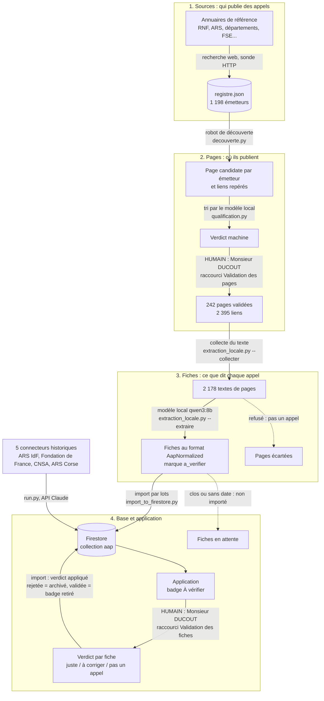

# Flux des données AAP Santé : d'un site d'émetteur à l'écran de l'application

Écrit le 2026-10-14 à la demande de Monsieur DUCOUT, pour lire d'un coup d'œil où entrent les données,
où un humain tranche, et ce qui est automatique. À tenir à jour avec `FEUILLE_DE_ROUTE.md`.

## Le schéma

Trait plein : flux en place. Trait pointillé : flux en attente ou non construit. « HUMAIN » : une décision de
Monsieur DUCOUT, prise à l'écran, enregistrée dans un fichier de verdicts rejouable.

## Les quatre étages, et ce que veut dire chaque mot

| Mot | Ce que c'est | Où c'est enregistré | Qui décide |
|---|---|---|---|
| Source (émetteur) | Un organisme qui publie des appels : ARS, fondation, département, ministère | `scraping/sources/registre.json` | Annuaires + session, aucune validation humaine pour l'instant |
| Page validée (rubrique confirmée) | La page du site de l'émetteur qui liste ses appels | champ `qualification` du registre, `relecture_qualification.json` | Modèle local, puis Monsieur DUCOUT à l'écran (257 verdicts le 2026-10-13) |
| Lien (adresse candidate) | Sur une page validée, un lien qui ressemble à un appel | `scraping/decouverte/<id>/liens.json` | Robot (mots-clés), personne ne relit |
| Texte collecté | Le texte lisible de la page d'un lien, lu par le navigateur | `scraping/decouverte/<id>/fiches/*.txt` | Automatique |
| Extraction | Le modèle local lit le texte, dit si c'est un appel, et remplit une fiche | `scraping/results/extraction_locale.json` | Modèle local (qwen3:8b), zéro euro |
| Page refusée | Texte jugé « pas la fiche d'un appel » (liste, article, page bloquée) | `results/extraction_locale_non_aap.json` | Modèle local |
| Échec | Texte trop long pour le modèle (délai dépassé) | `results/extraction_locale.errors.json` | Automatique |
| Fiche | Un appel structuré : titre, financeur, dates, montants, description | fichier ci-dessus, puis Firestore | Modèle local, marque « à vérifier » |
| Import | Copie des fiches dans la base de l'application, sans doublon, en ignorant les appels clos et sans date | `scripts/import_to_firestore.py` | Automatique, rejouable |
| Lot | Un import exécuté pendant l'extraction, sur tout ce qui a été produit jusque-là | journal de session | Session |
| À vérifier | Marque posée sur toute fiche venue du modèle local (environ 1 champ faux sur 4 fiches) | étiquette `a-verifier` dans Firestore, badge dans l'application | Automatique ; levée par un verdict humain (à construire) |
| Verdict | Décision de Monsieur DUCOUT sur une page ou une fiche, avec commentaire | `results/validation_pages.json`, `validation_liens.json`, `validation_manuelle.json` | Monsieur DUCOUT |

## Ce qui est validé par un humain aujourd'hui, et ce qui ne l'est pas

- Validé : les pages des émetteurs (étape 2). C'est la décision prise le 2026-10-13.
- Pas validé : les émetteurs eux-mêmes (étape 1, pris dans des annuaires de référence), les liens repérés
  (étape 2, mots-clés), et les fiches extraites (étape 3, d'où la marque « à vérifier »).
- Retour des verdicts (fait le 2026-10-14, changement `organisation-donnees-validees`) : le verdict de
  Monsieur DUCOUT sur une fiche (`scraping/sources/verdicts_fiches.json`) est appliqué par l'import : « pas un
  appel » archive la fiche, « juste » retire le badge et protège les champs, « à corriger » garde le badge avec
  le commentaire. L'import ne réécrit jamais un statut ou une validation existants.

## Chiffres au 2026-10-14, 10 h (source : `extraction_locale.py --bilan`, import à blanc)

- 242 pages validées, 2 395 liens, 2 178 textes collectés.
- Extraction en cours : 434 fiches, 363 pages refusées, 16 échecs, 1 365 textes restants.
- Base : 221 appels visibles, dont 126 « À vérifier » ; 202 fiches closes et 80 sans date non importées.
