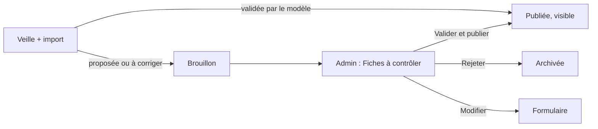

# Design

## Contexte

`validation.statut` est la seule source de fiabilité d'une fiche (lot 0). L'import publie toute fiche datée et la
marque « proposée » quand ni Monsieur DUCOUT ni le modèle n'ont tranché ; la recherche publique montre toutes les
fiches publiées avec un badge « Non relue ». `ManageAAPsPage` sait déjà publier, clôturer, archiver, supprimer et
filtrer par validation. Les règles Firestore déployées laissent l'administrateur mettre à jour tout appel.

## Décisions

1. **Visibilité publique = validée ou saisie à la main** : `visiblePubliquement(aap)` dans `utils/relecture.ts`,
   appliquée au chargement de la recherche. Pourquoi côté application et non par une requête : le statut de validation
   est un sous-champ, et la liste publique est déjà filtrée en mémoire.
2. **Import** : `publication_selon_controle(doc)` passe `status` à `draft` quand la validation est « proposée » ou
   « à corriger » et que le relecteur n'est pas Monsieur DUCOUT ; appelée après la décision du modèle. Les documents
   existants gardent leur statut (champs humains jamais réécrits), d'où le script de dépublication.
3. **Verdicts pris dans l'application** : écrits dans `aap.validation` avec `par = "Monsieur DUCOUT"` et la date du
   jour. L'import protège déjà `validation` et `status` ; ces verdicts ne sont pas recopiés dans
   `verdicts_fiches.json` (fichier des verdicts de l'outil de validation en ligne de commande) : les deux chemins
   coexistent, la base fait foi. À unifier plus tard si l'outil en ligne de commande reste utilisé.
4. **Filtre dans l'adresse** : `?validation=` et `?status=` lus au montage de `ManageAAPsPage` (même mécanisme que la
   recherche publique), pour que la carte du tableau de bord et un futur e-mail mènent directement à la bonne liste.
5. **Modification par l'administrateur** : `EditAapPage` accepte l'administrateur en plus de l'auteur ; le formulaire
   `CreateAapPage` enregistre par `updateAap`, qui ne touche ni `validation` ni `status`.

## Flux

## Risques

- La dépublication est une migration : essai à blanc, sauvegarde JSON dans `scripts/sauvegardes/`, exécution
  seulement sur accord écrit.
- La session ne joue pas l'administration connectée : preuve par tests, lint, build et essai à blanc du script.
