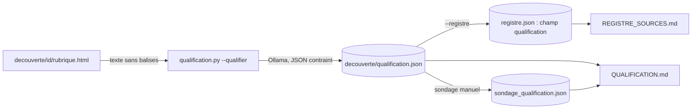

# Design

## Context

La découverte a gardé, pour 270 sources, `decouverte/<id>/rubrique.html` et `liens.json`. Le
registre (`sources/registre.json`) accepte des champs supplémentaires (le contrôle de format ne
vérifie que les champs obligatoires). Ollama 0.40 est installé avec `mistral:7b-instruct` et
répond en JSON contraint par l'option `format`, comme dans `echantillon.py`.

## Goals / Non-Goals

**Goals :** un verdict honnête par source, un taux d'accord mesuré entre le modèle local et une
relecture humaine, un registre qui dit enfin combien de sources publient des appels à projets.
**Non-Goals :** extraire les fiches, lire les PDF, qualifier les sources sans page gardée.

## Decisions

### Décision 1 : la page entière plutôt que les liens notés

Les liens notés par mots-clés sont justement ce qui a trompé. On donne au modèle le texte visible
de la page (balises retirées, scripts et styles exclus, 8 000 caractères au plus), qui contient
les titres des appels, les dates et les mentions "PDF". Sans dépendance nouvelle : une expression
régulière suffit pour retirer les balises.

### Décision 2 : questions fermées, schéma JSON imposé

Le modèle répond à `liste_aap` (oui/non), `nb_aap` (entier), `forme` (html, pdf, mixte),
`sante_medico_social` (oui/non) et `justification` (une phrase). Le verdict est calculé par le
script à partir de ces réponses, pas par le modèle, pour rester lisible et testable :
pas d'AAP -> `pas-d-aap` ; AAP hors santé -> `hors-sante` ; AAP en PDF seulement ->
`pdf-seulement` ; sinon `rubrique-confirmee`.

### Décision 3 : sondage de 30 verdicts minimum, par famille

Un modèle de 7 milliards de paramètres se trompe. Le sondage mesure combien ; en dessous de
80 % d'accord, les verdicts seront repassés avec `qwen3.6` (plus lent) ou relus à la main.

### Décision 4 : champ `qualification` dans le registre, `statut` inchangé

`statut` décrit l'avancement technique (page vérifiée, connecteur...). `qualification` décrit le
contenu. Les deux se lisent côte à côte dans `REGISTRE_SOURCES.md`.

## Risks / Trade-offs

- [Page de rubrique trop longue ou surtout faite de menus] → 8 000 caractères du contenu après
  retrait des zones de navigation ; si le modèle répond "aucun AAP" sur une page que les liens
  notés disaient riche, le verdict est `a-verifier`, pas `pas-d-aap`.
- [Modèle local lent] → traitement en arrière-plan, reprise par identifiant.
