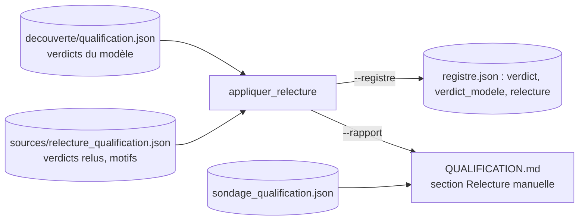

# Design

## Context

`qualification.py` lit `decouverte/qualification.json` (verdicts du modèle, un par rubrique) et le
reporte dans le registre et dans `QUALIFICATION.md`. Le sondage manuel
(`decouverte/sondage_qualification.json`) mesure le taux d'accord du modèle sur 31 verdicts
tirés au sort ; il ne modifie pas les verdicts.

## Goals / Non-Goals

**Goals :** corriger les verdicts sans perdre celui du modèle, tracer chaque correction (motif,
date, relecteur) dans Git, garder les commandes existantes.
**Non-Goals :** modifier le sondage (il mesure le modèle, pas le résultat final), rejuger les
pages par Ollama, toucher au schéma `AapNormalized`.

## Decisions

### Décision 1 : un fichier de relecture à part, versionné dans `sources/`

Le dossier `decouverte/` est ignoré par Git (volumineux, régénérable). Les corrections humaines
sont au contraire le travail le plus précieux : elles vont dans `scraping/sources/`, à côté du
registre, et sont commitées. Format : identifiant de source -> `{verdict, motif, date, relecteur}`,
plus une clé `_note` de commentaire (même convention que le sondage).

### Décision 2 : le verdict relu s'applique à la lecture, pas à l'écriture

`appliquer_relecture()` est une fonction pure qui prend les verdicts du modèle et la relecture et
rend une copie corrigée. Elle est appelée au moment de `--registre` et de `--rapport`. Ainsi
`qualification.json` reste la sortie brute du modèle (rejouable) et la relecture reste un fichier
séparé, relisible.

### Décision 3 : le verdict du modèle reste visible

Dans le registre et le rapport, une source corrigée porte `verdict` (relu) et `verdict_modele`
(d'origine). On peut ainsi mesurer plus tard combien de corrections ont été nécessaires par famille,
et décider si le modèle local suffit pour le passage global.

### Décision 4 : « à vérifier » plutôt que deviner

Quand la page gardée ne permet pas de conclure (page d'accueil, archives, bandeau cookies, liste
mixte), le verdict relu est `a-verifier` avec le motif. Le verdict final n'est écrit qu'après
relecture de la page et accord de Monsieur DUCOUT.

## Risks / Trade-offs

- [Identifiant mal orthographié dans la relecture] → ignoré avec un avertissement sur la sortie
  d'erreur, pas d'arrêt ; le fichier initial est généré par un script qui vérifie chaque
  identifiant contre `qualification.json`.
- [Verdict relu hors liste] → erreur explicite (`ValueError`), le traitement s'arrête.
- [Le décompte du rapport change de sens] → la phrase de synthèse compte les verdicts relus ; la
  section « Relecture manuelle » dit combien ont été corrigés, pour que les chiffres restent
  comparables au rapport précédent.
