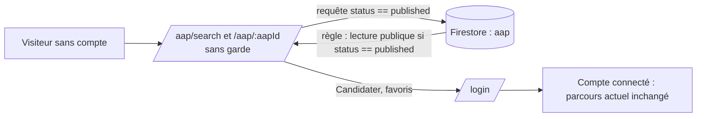

# Design

## Context

Aujourd'hui, `app/firestore.rules` n'autorise la lecture de `aap` qu'aux comptes connectés avec
abonnement actif ou essai (`isAuthenticated() && hasActiveSubscription()`). Dans `App.tsx`, les routes
`/aap/search` et `/aap/:aapId` sont enveloppées par `ProtectedRoute`, `SubscriptionGuard` et, pour la
recherche, `RoleGuard` (porteur). La page de recherche ne dépend pas du compte (elle interroge
Firestore avec `status == 'published'`) ; la fiche n'utilise le profil que pour afficher le bouton
« Candidater ».

## Goals / Non-Goals

**Goals :** voir la liste et la fiche d'un AAP publié sans aucun compte ; ne rien changer pour les
actions qui engagent (candidature, publication, évaluation).
**Non-Goals :** corriger la connexion, activer Google, ouvrir d'autres pages.

## Decisions

### Décision 1 : la règle Firestore s'appuie sur le statut du document, pas sur une liste blanche

`allow read: if resource.data.status == 'published' || (isAuthenticated() && hasActiveSubscription());`
Pourquoi : c'est la donnée elle-même qui dit si elle est publique. Les requêtes de liste de
l'application filtrent déjà sur `status == 'published'`, condition que Firestore exige pour accepter
une requête sous cette règle ; les requêtes des financeurs sur leurs propres AAP (brouillons compris)
passent par la seconde branche, inchangée.

### Décision 2 : retirer les gardes des deux routes plutôt que créer un mode « démo »

Un mode démo (contournement des gardes en développement) laisserait le produit final fermé et
créerait deux comportements à maintenir. Retirer les gardes de ces deux routes rend le comportement
identique en local et en production, conforme au principe « les AAP sont publics ».

### Décision 3 : les actions réservées renvoient vers la connexion

Sur la fiche, « Candidater » et le bouton favori s'affichent pour tout visiteur ; sans compte, le clic
mène à `/login` avec l'adresse de retour (mécanisme `location.state.from` déjà présent dans
`LoginPage`). Pourquoi : montrer ce que le compte apporte, sans bloquer la lecture.

### Décision 4 : déploiement des règles sur demande explicite

`firebase deploy --only firestore:rules --project aapi-11bc3` modifie le projet Firebase : la tâche
correspondante attend l'accord de Monsieur DUCOUT (règle du projet : confirmation avant toute
modification de base ou de configuration).

## Risks / Trade-offs

- [Lecture publique de tous les AAP publiés, y compris ceux saisis par des financeurs] → c'est le
  choix produit : un appel à projets publié est public. Les brouillons restent protégés.
- [Quota de lectures du forfait Spark épuisé par des visites anonymes] → négligeable en local ; à
  surveiller seulement après déploiement public (hors périmètre pour l'instant).
- [Règles déployées sans la modification des routes, ou l'inverse] → les deux tâches sont dans le
  même changement et vérifiées ensemble par le scénario « visiteur sans compte ».
