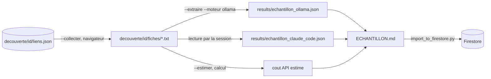

# Design

## Context

Les textes des fiches viennent des liens stockés dans `decouverte/<id>/liens.json`. Le format de
sortie est `AapNormalized` (`scraping/schema.py`), inchangé. `extractor.py` contient déjà le
schéma d'outil Claude (`EXTRACTION_TOOL`) et les tarifs : on les réutilise pour le prompt des
autres moteurs et pour l'estimation.

## Goals / Non-Goals

**Goals :** mesurer honnêtement la qualité et le coût de trois moteurs sur les mêmes textes ;
rendre quelques dizaines de fiches visibles dans l'application ; zéro euro dépensé.
**Non-Goals :** industrialiser l'extraction, traiter les pièces jointes, choisir le moteur à la
place de Monsieur DUCOUT.

## Decisions

### Décision 1 : texte lisible de la page, pas le HTML

Le navigateur piloté rend la page puis on garde le texte visible du contenu principal (sans
en-tête ni pied de page, même sélecteur de navigation que `decouverte.py`). Un texte court coûte
moins cher à l'API et tient dans la fenêtre d'un modèle local.

### Décision 2 : Ollama par son API HTTP locale avec format JSON contraint

Ollama expose `POST http://localhost:11434/api/chat` ; l'option `format` accepte un schéma JSON,
ce qui force une sortie structurée comme le fait l'outil Claude. On lui passe le même schéma que
`EXTRACTION_TOOL["input_schema"]`. Modèle de départ : `mistral:7b-instruct` (4 Go, tient dans la
carte graphique) ; `qwen3.6` (23 Go) seulement si la qualité est insuffisante, en acceptant la
lenteur. [A VALIDER - Monsieur DUCOUT : le port 11434 par défaut n'a pas été changé]

### Décision 3 : Claude Code écrit les fiches à la main, sans script

La session lit les fichiers texte et écrit le JSON. C'est volontairement non automatisable :
cela mesure la qualité atteignable "au mieux" et sert de référence pour juger Ollama.

### Décision 4 : estimation API par règle de trois

Nombre de caractères divisé par 4 pour approcher les tokens d'entrée, 1 200 tokens de sortie
par fiche (valeur constatée dans `logs/extraction_costs.jsonl` si présent, sinon hypothèse
marquée), tarifs de `extractor.py`, taux de change euro arrondi. C'est une estimation haute,
sans cache.

### Décision 5 : contrôle manuel sur quatre champs

Titre, financeur, date de clôture, montant : ce sont les champs affichés par l'application. Une
fiche est "juste" si les quatre correspondent à la page. Le contrôle est noté dans un fichier
`results/controle_echantillon.json` rempli à la main, lu par `--rapport`.

## Risks / Trade-offs

- [Modèle local trop faible : JSON invalide ou dates fausses] → compté comme échec, visible
  dans le rapport ; c'est précisément ce que l'on veut mesurer.
- [Fiches de listing au lieu de fiches d'AAP parmi les liens] → limite de cinq fiches par
  rubrique, les liens les mieux notés d'abord ; fiche sans date ni montant signalée.
- [Textes très longs] → coupés à 80 000 caractères comme dans `extractor.py`.
