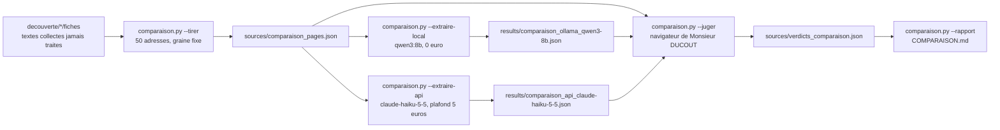

# Design

## Context

État vérifié le 2026-10-14 (`extraction_locale.py --bilan`) : 242 sources en rubrique confirmée, 2 395 adresses,
2 178 textes collectés dans `decouverte/<source>/fiches/`, 754 fiches produites et 619 pages refusées par
`qwen3:8b` (1 391 pages traitées), 787 textes restants, passage global toujours en cours en tâche de fond.
Mesure Haiku du même jour sur l'échantillon (`ECHANTILLON.md`) : 45 textes, 19 justes sur 20 comparées,
1 fabriquée, 4 pages de référence refusées à tort, 66 appels, 0,028 euro.

Outils réutilisés : chaîne d'extraction d'`echantillon.py` (question fermée, extraction, contrôle des formats,
consigne version 3, commune au passage local et au moteur api), journal des coûts `logs/extraction_costs.jsonl`,
serveur local de `validation.py` comme modèle de l'écran de jugement (bibliothèque standard, verdicts sur le disque).

Décision de Monsieur DUCOUT à l'accord sur le plan (2026-10-14) : les 50 pages doivent être des pages jamais
traitées ; les deux moteurs les traitent donc à neuf.

## Goals / Non-Goals

Goals : deux pourcentages par moteur (repérage, qualité) sur les mêmes 50 pages, jugées par Monsieur DUCOUT ;
coût réel et temps consignés ; tout rejouable.
Non-Goals : choisir le moteur ; améliorer l'un ou l'autre moteur ; mesurer d'autres modèles.

## Decisions

### Décision 1 : tirage parmi les pages d'appels des financeurs de la santé (second tirage du 2026-10-14)

Premier tirage (matin) : 50 pages jamais traitées par le passage local, toutes de la famille collectivités, seuls
textes restants ; résultat sans aucun appel de santé et avec 18 pages de navigation, jugé inutilisable par
Monsieur DUCOUT, à raison : l'objectif est de comparer les moteurs sur les appels que cherchent hôpitaux et
cliniques (ARS, INCa, CNSA, fondations de santé). La session a appliqué « jamais traitées » à la lettre au lieu de
s'arrêter. Fichiers archivés sous le suffixe `collectivites` (liste, 18 verdicts, résultats des deux moteurs).
Second tirage : 50 adresses, graine 2026, parmi les textes collectés des sources des familles ARS, caisses
nationales, fondations, sociétés savantes, établissements, plus l'INCa et l'Inserm (81 sources), dont le texte
contient un mot d'appel (« appel à projets », « appel à candidatures », « appel à manifestation », « date limite »,
« candidature », « dossier de candidature », « cahier des charges »), hors des 45 adresses de l'échantillon, au
prorata des familles : 458 candidats, 50 tirées (ARS 20, fondations 11, caisses 8, INCa et Inserm 5,
établissements 4, sociétés savantes 2). Pourquoi un mot dans le texte plutôt que le score du lien : 152 des 184
pages d'appels des ARS ont un lien sans mot-clé (le titre de l'appel) ; le mot dans le texte écarte menus et
contrôles anti-robot sans dépendre du lien. La condition « jamais traitées » est abandonnée : ces pages ont été
vues par le passage global, mais les deux moteurs les retraitent à neuf dans des fichiers distincts, ce qui est le
protocole de la comparaison.

### Décision 2 : le modèle local recalcule les 50 textes, pendant le passage global

`comparaison.py --extraire-local` appelle `echantillon.extraire` avec la liste explicite des 50 textes et le
fichier `results/comparaison_ollama_<modele>.json` : même chaîne que le passage global (question fermée,
extraction, contrôle des formats avec seconde chance, consigne version 3). Pourquoi ne pas attendre la fin du
passage global : il reste environ dix heures ; Ollama met les demandes en file, la comparaison avance donc en
concurrence avec lui, et les durées locales sont majorées. Le rapport le signale ; une mesure de temps propre
demanderait de relancer `--extraire-local` sur un nouveau fichier après la fin du passage global.

### Décision 3 : Haiku par la fonction existante, généralisée

`echantillon.extraire_api(resultats, modele, limite, plafond, adresses=None, chemin_sortie=None)` et
`echantillon.extraire(..., fiches=None)` : sans les nouveaux paramètres, comportement inchangé (échantillon et
passage global) ; avec, la comparaison passe ses 50 textes et ses propres fichiers de sortie. Pourquoi : un seul
code pour chaque protocole (local avec seconde chance, api sans seconde chance payante, journal, plafond cumulé,
reprise), donc un seul endroit à relire. Les textes du moteur api sont trouvés par adresse (`fiches_par_adresse`).

### Décision 4 : écran de jugement dédié, verdicts séparés

`comparaison.py --juger` sert sur `http://localhost:8766` une page par adresse : extrait du texte collecté (le
texte qui a été soumis aux deux moteurs fait foi, pas la page vivante), lien officiel, fiche locale et fiche Haiku
côte à côte (titre, financeur, date de clôture, montants, enveloppe) ou la mention « refusée » avec la raison du
moteur. Boutons : pour la page, « c'est un appel » / « ce n'est pas un appel » ; pour chaque moteur, « fiche juste »
/ « fiche à corriger » (actif seulement si une fiche existe). Verdicts écrits dans
`sources/verdicts_comparaison.json`, clé = adresse : `{"page": "appel" | "pas-un-appel", "local": ..., "api": ...,
"commentaire", "date"}`. Pourquoi un fichier séparé : `verdicts_fiches.json` est lu par l'import de l'application,
un verdict de comparaison ne doit pas y entrer. Le serveur ne lit que les adresses de la liste (même garde que
`validation.py`). Relancer l'écran reprend à la première page sans verdict.

### Décision 5 : les mesures, calculées par des fonctions pures testées

Pour chaque moteur, sur les 50 pages jugées :
- repérage = (pages « appel » où le moteur a produit une fiche + pages « pas un appel » que le moteur a refusées)
  / 50 ;
- qualité = fiches « juste » / pages jugées « appel » (une page « appel » sans fiche compte comme fausse, une
  fiche « à corriger » aussi) ;
- fabrications = fiches produites sur des pages « pas un appel » ;
- temps = somme des durées enregistrées ; coût = journal des coûts pour Haiku, 0 pour le local.
Pourquoi deux taux et non un seul : Monsieur DUCOUT a demandé le repérage et la qualification séparément ; une
page refusée à tort pèse sur le repérage et sur la qualité, ce qui correspond à l'expérience du lecteur.

### Décision 6 : rapport et accord

`--rapport` écrit `scraping/COMPARAISON.md` : tableau par moteur (repérage, qualité, fabrications, temps, coût),
liste des 50 pages avec les trois verdicts, date, graine, versions. Aucun appel API avant l'accord écrit de
Monsieur DUCOUT sur le modèle (`claude-haiku-5-5`), le prix vérifié le 2026-10-14 (0,10 et 0,50 USD par million
de tokens) et le coût estimé (0,03 euro, moins de 0,10 euro avec marge) ; un premier texte seul (`--limite 1`),
coût lu dans le journal, puis les 49 autres.

## Risks / Trade-offs

- Biais du tirage vers les familles déjà traitées : accepté, documenté dans le rapport.
- Une page peut avoir changé depuis la collecte : le texte collecté fait foi pour les deux moteurs et pour le
  jugement, qui l'affiche.
- Certains textes collectés sont des contrôles anti-robot (constaté le 2026-10-14 : 1 page sur les 50 tirées, oise.fr ;
  35 textes sur 751 candidats portent une marque de ce type, souvent « cloudflare », parfois légitime). Ces pages sont
  jugées « pas un appel » sur le texte collecté, ce qui ne départage pas les moteurs ; un filtre des contrôles
  anti-robot avant le tirage est à prévoir pour une prochaine comparaison.
- Le tirage n'est reproductible que tant que le passage global n'a pas traité de nouvelles pages : la liste écrite
  dans `sources/comparaison_pages.json` fait foi, `--tirer` ne doit pas être relancé après coup.
- Le jugement humain de 50 pages prend du temps ; l'écran reprend là où il s'est arrêté.
- Le modèle local a eu une seconde chance sur les écarts de format, pas Haiku : différence héritée de
  l'échantillon, rappelée dans le rapport.

## Open Questions

- Graine et répartition par famille : proposées, à confirmer `[A VALIDER - Monsieur DUCOUT]`.
- Port 8766 et raccourci `comparaison_juger.cmd` sur le bureau, comme les autres modes de validation.
