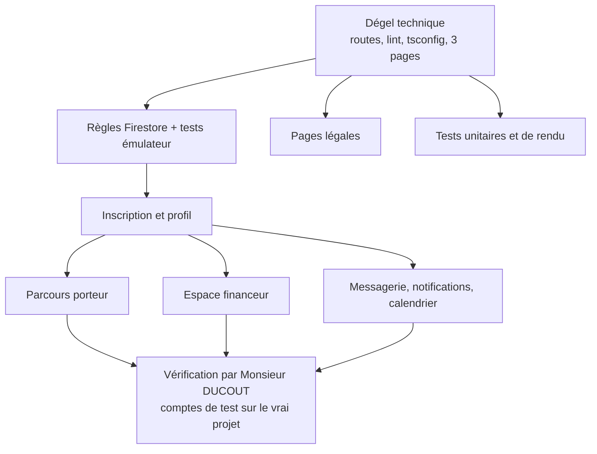

# Design

## Contexte

Les modules ont été écrits en avril 2026 (huit phases du cahier des charges), déployés en test, puis gelés le
2026-10-14 sans modification : routes retirées de `App.tsx`, fichiers ignorés par le lint, trois fichiers exclus de la
compilation (`deadline.toDate()` sur une date devenue nulle), écritures Firestore interdites. Le dégel inverse ces
quatre mesures, un volet à la fois, et ajoute ce qui manquait : pages légales et tests.

## Décisions

1. **Dégel par inversion, pas par réécriture** : les pages d'avril sont reprises telles quelles ; seules les erreurs de
   compilation (date nulle) et de lint sont corrigées, chirurgicalement. Pourquoi : le code a déjà tourné en test ;
   le réécrire sans l'avoir vu échouer serait du travail spéculatif.
2. **Date de clôture nulle** : les pages qui calculent une échéance ignorent les appels sans date (calendrier,
   recommandations) ou affichent « Non précisée » (mes appels), comme la recherche le fait déjà.
3. **Règles Firestore** : retour aux règles d'avant le lot 0 pour les collections des modules, en gardant les acquis du
   lot 0 (lecture publique des appels publiés, administrateur seul à publier un appel importé, `users` créé par son
   propriétaire). Création d'un appel par un financeur : `financeurId` doit valoir son identifiant, et l'appel naît sans
   bloc `validation`, donc sans mention de relecture (appel saisi à la main).
4. **Vérification des parcours connectés** : la session ne crée pas de compte sur le vrai projet Firebase (règle de
   sécurité de la session) ; elle vérifie ce qui se voit sans compte (inscription affichée, redirections, pages légales)
   et Monsieur DUCOUT joue les parcours avec des comptes de test. Si cela devient un frein, l'émulateur Auth local sera
   ajouté dans un changement suivant.
5. **Pages légales** : trois composants React avec le texte en dur, pas de gestion de contenu ; le texte cite les
   traitements réels de l'application (comptes, profils, candidatures, messages, fiches collectées sur des sites publics)
   et les sous-traitants réels (Google Firebase, hébergeur du site). Les données d'entreprise absentes du dépôt sont
   marquées à valider plutôt qu'inventées.
6. **Tests** : Vitest déjà présent ; ajout de `@testing-library/react`, `@testing-library/jest-dom` et `jsdom` en
   dépendances de développement (légères, standard du gabarit Vite). Les tests de rendu reçoivent des données en
   mémoire : aucun appel Firebase dans les tests.
7. **Fonctions serveur** hors périmètre : notifications automatiques, alertes e-mail et paiement attendent la
   confirmation de Blaze ; les pages correspondantes fonctionnent avec les données déjà en base.

## Risques

- Les pages d'avril peuvent contenir des erreurs de logique invisibles au lint ; elles apparaîtront à la vérification
  de Monsieur DUCOUT et seront corrigées une à une.
- Rouvrir l'inscription publique sur le projet de test expose à des inscriptions parasites : acceptable en test, à
  revoir avant toute mise en ligne (vérification d'e-mail déjà envoyée par Firebase).
