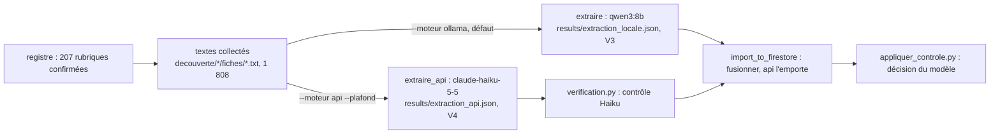

# Design

## Contexte

Deux chaînes d'extraction existent dans `scraping/echantillon.py` : `extraire` (modèle local, liste de textes ou
rubriques, métadonnées libres, fichier de sortie libre) et `extraire_api` (moteur API, adresses de l'échantillon,
plafond, journal des coûts). Le passage global `extraction_locale.py` n'appelle que la première. La V4 consiste à
appeler la seconde sur les mêmes textes, sans dupliquer de code.

## Décisions

1. **Un fichier de sortie par moteur** (`extraction_api.json`), pas de réécriture de `extraction_locale.json`. Pourquoi :
   la V3 reste lisible et comparable ; la règle `fusionner` de l'import (connecteur ou API l'emporte sur `ollama`)
   choisit déjà la fiche API pour une adresse commune.
2. **`extraire_api` généralisée** avec `fiches` et `metadonnees`, comme `extraire`, plutôt qu'une troisième fonction.
   Pourquoi : la chaîne API est déjà testée (échantillon, comparaison) ; seul le périmètre change.
3. **Devis obligatoire** (`--dry-run`) avec les hypothèses prudentes de `estimation_appel_euros` (trois appels par texte,
   30 % de jetons en plus) : le chiffre annoncé est un maximum. Le coût réel est lu dans `logs/extraction_costs.jsonl`
   après coup et collé dans `tasks.md`.
4. **Plafond explicite** (`--plafond`, défaut 5 euros, cumul du modèle lu dans le journal) : l'outil s'arrête avant
   l'appel qui dépasserait, comme dans l'échantillon.
5. **Tous les textes sont renvoyés à l'API**, y compris les 1 070 pages refusées par le local : la mesure du 2026-10-14 a
   montré que le local refusait à tort des pages de référence ; le refus par Haiku coûte un seul appel court.
6. **Même ordre des familles** (ARS d'abord, collectivités en dernier) et import possible en cours de route.

## Risques

- Coût : 2,26 euros au plus, plafond 5 euros cumulés ; arrêt automatique.
- Erreurs 429 ou 5xx de l'API : `extractor._appeler` fait déjà les reprises ; un échec est écrit dans
  `extraction_api.errors.json` et n'arrête pas le passage.
- Doublons locaux et API dans la base : traités par `fusionner` ; les fiches locales dont l'adresse n'est pas reprise par
  l'API (texte absent ou échec) restent telles quelles, visibles par `scrapeMetadata.moteur`.

## Hors périmètre

Rejeu périodique (lot 2), nouvelles sources (lot 3), remplacement des cinq connecteurs historiques.
