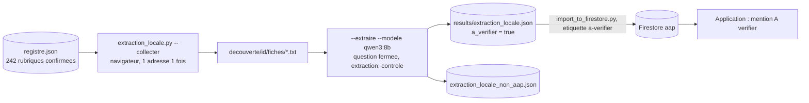

# Design

## Context

`echantillon.py` sait déjà, pour une liste de rubriques `{id, nom, categorie}` : lire les liens de
`decouverte/<id>/liens.json`, enregistrer le texte des pages dans `decouverte/<id>/fiches/`, poser
la question fermée, extraire, contrôler les formats et écrire fiche par fiche avec reprise. Il ne
sait travailler que sur 10 rubriques (une par famille) et 5 fiches par rubrique, et écrit dans un
fichier `echantillon_*.json` ignoré par l'import global.

## Goals / Non-Goals

**Goals :** produire, à zéro euro, une fiche par page d'appel des 242 rubriques validées ; rendre
ces fiches visibles dans l'application avec une marque claire ; pouvoir arrêter et reprendre.
**Non-Goals :** améliorer la qualité du modèle (réglage fin, autre modèle) ; lire les fichiers ;
changer `AapNormalized` ou le type `AAP`.

## Decisions

### Décision 1 : un nouvel outil qui importe `echantillon.py`, pas une copie

`extraction_locale.py` importe les fonctions d'`echantillon.py`. Une seule modification
chirurgicale dans `echantillon.py` : `extraire` reçoit un chemin de sortie optionnel (par défaut
le fichier par modèle de l'échantillon) et un dictionnaire de métadonnées ajoutées à chaque fiche
(`a_verifier`). Pourquoi : la logique sondée (formats, seconde demande) reste en un seul endroit ;
les tests existants continuent de la couvrir.

### Décision 2 : collecte de tous les liens web, une adresse une seule fois

`liens_a_lire` de l'échantillon garde les 5 mieux notés ; ici on garde tous les liens web (les
fichiers PDF, Word, Excel, ZIP restent hors périmètre). Deux sources citent parfois la même
adresse (Région Île-de-France et Conseil régional Île-de-France, Drôme et sa commission des
financeurs) : un ensemble global des adresses vues évite de lire et d'extraire deux fois. Le
texte est rangé sous la première source rencontrée.

### Décision 3 : un seul fichier de sortie, lu par l'import global

`results/extraction_locale.json` ne commence pas par `echantillon_` : l'import global le lit.
Chaque fiche porte `scrape_metadata.source` (identifiant du registre), `moteur = "ollama"`,
`modele`, `a_verifier = true`. L'import ajoute l'étiquette `a-verifier` quand `moteur` vaut
`ollama` : l'étiquette est dérivée de la provenance, pas saisie.

### Décision 4 : ordre des sources

ARS, caisses nationales, fondations, agences nationales, ministères, sociétés savantes,
établissements, Europe, autres, puis collectivités. Les collectivités portent 1 528 des 3 236
liens et les listes les plus mixtes (culture, sport, eau) : les traiter en dernier donne d'abord
des lots proches du champ santé. Dans une famille, l'ordre du registre.

### Décision 5 : import par lots, mention dans l'application

L'import est rejouable (identifiant = signature), donc on l'exécute plusieurs fois pendant
l'extraction. Dans l'application, un badge « À vérifier » (variante `warning` du composant `Badge`
existant) est affiché quand l'étiquette `a-verifier` est présente ; aucun champ nouveau dans le
type `AAP`.

## Risks / Trade-offs

- [25 à 40 heures de calcul] → reprise automatique, bilan à tout moment ; l'ordinateur doit
  rester allumé (veille désactivée pendant la session).
- [Le modèle dépasse le délai sur un texte long] → compté comme échec dans `.errors.json`, pas
  d'arrêt ; même borne de 80 000 caractères que l'échantillon.
- [Fiches fausses visibles dans l'application] → marque « À vérifier » ; vérification humaine
  avec `validation.py --fiches` ensuite ; suppression possible par l'identifiant de signature.
- [Appels clos extraits pour rien] → l'import ignore les appels expirés ; le temps de calcul est
  perdu mais rien n'entre en base.
