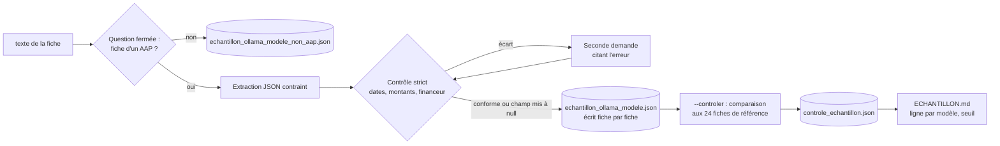

# Design

## Context

`echantillon.py --extraire` envoie aujourd'hui chaque texte à Ollama en un seul appel, avec un
schéma JSON imposé, puis valide la fiche avec `AapNormalized` (qui accepte des dates sous forme de
texte libre). Les 45 textes sont dans `decouverte/<id>/fiches/`, les 24 fiches de référence dans
`results/echantillon_claude_code.json`, les 21 pages hors sujet dans `results/echantillon_non_aap.json`.
Carte graphique : RTX 5060 portable, 8 Go. `mistral:7b-instruct` (4,4 Go) y tient.

## Goals / Non-Goals

**Goals :** mesurer, à zéro euro et sans jugement humain supplémentaire, si un modèle local atteint
le seuil fixé ; garder chaque tour rejouable et comparable.
**Non-Goals :** modifier `AapNormalized` (le contrôle strict est dans `echantillon.py`, pas dans le
schéma) ; lancer le passage global ; tester des modèles qui ne tiennent pas en mémoire graphique.

## Decisions

### Décision 1 : une question fermée avant d'extraire

Le premier tour a montré que le modèle « remplit » toujours le schéma, même pour une facture d'eau.
La question fermée (`{"est_aap": bool, "raison": str}`) sépare la décision de l'extraction, comme
pour la qualification où cette forme a bien fonctionné. Les pages refusées sont gardées dans un
fichier pour être comparées aux 21 pages hors sujet de la session : la précision du filtre est
mesurée, pas supposée.

### Décision 2 : contrôle strict et seconde chance, puis null

Le schéma JSON d'Ollama ne contraint pas le format des dates. Après extraction, le script vérifie :
`date_ouverture` et `date_cloture` au format AAAA-MM-JJ ou null ; `montant_min`, `montant_max`
entiers ou null ; `enveloppe_globale` contenant un nombre ou null ; `financeur` non vide. En cas
d'écart, une seconde demande cite le champ et l'erreur (« date_cloture doit être AAAA-MM-JJ ou
null, reçu : 20 Septembre 2026 »). Si l'écart persiste, le champ passe à null et la fiche porte
`scrape_metadata.a_relire = true`. Pourquoi null plutôt qu'une valeur devinée : une date fausse
est pire qu'une date absente pour un porteur.

### Décision 3 : un fichier par modèle, écrit au fil de l'eau

`results/echantillon_ollama_<modele>.json` (modèle en minuscules, caractères non alphanumériques
remplacés par `-`, par exemple `echantillon_ollama_mistral-7b-instruct.json`). Le fichier est
réécrit après chaque fiche : un arrêt (délai, coupure) ne perd rien, et la reprise saute les fiches
déjà faites. Le rapport découvre tous les fichiers `echantillon_ollama_*.json` ; le fichier
`echantillon_ollama.json` du premier tour reste lu sous le nom « ollama (premier tour) ».

### Décision 4 : contrôle automatique contre la référence

`--controler --modele <modele>` compare chaque fiche au document de référence de même adresse :
titre égal après normalisation (minuscules, sans accents ni ponctuation, espaces réduits) ou inclus
l'un dans l'autre ; financeur de référence contenu dans celui produit ou inversement ; date de
clôture égale ; montant : `montant_max` et `enveloppe_globale` (nombre extrait) égaux à la
référence, null compris. Le résultat remplit `controle_echantillon.json` sous la clé du modèle, sans
toucher aux colonnes existantes. Un sondage humain de 5 fiches reste prévu pour vérifier le
comparateur lui-même.

### Décision 5 : modèles testés dans l'ordre, un à la fois

`mistral:7b-instruct` d'abord (comparable au premier tour), puis un modèle de 7 à 8 milliards de
paramètres récent (candidat `qwen3:8b`, téléchargement d'environ 5 Go sur accord de Monsieur
DUCOUT). Pas de second modèle chargé en parallèle (règle d'exploitation d'Ollama du projet).
`llama3.2:3b`, déjà installé, peut servir de point bas si le temps le permet.

### Décision 6 : le seuil est fixé avant le tour

Seuil proposé : 20 fiches justes sur 24 et au plus 2 fiches fabriquées sur 21 pages hors sujet.
Monsieur DUCOUT le confirme ou le modifie avant la première exécution (tâche 2.1) ; il est inscrit
dans `ECHANTILLON.md` et dans `tasks.md`, pour que la décision finale soit lisible.

## Risks / Trade-offs

- [Trois appels par texte : temps triplé] → une heure par modèle environ, acceptable ; écriture au
  fil de l'eau et reprise.
- [Le comparateur automatique juge mal un titre reformulé] → sondage humain de 5 fiches ; en cas
  de doute, la colonne reste corrigeable à la main comme aujourd'hui.
- [Le modèle téléchargé n'existe pas sous ce nom ou dépasse 8 Go] → vérifier avec `ollama pull`
  avant le tour ; à défaut, rester sur mistral et le dire.
- [Le seuil n'est pas atteint] → la décision prévue s'applique : estimation API sur les rubriques
  confirmées, changement suivant.
