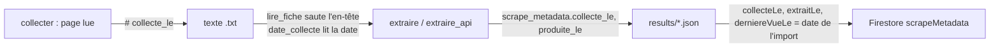

# Design

## Contexte

Un texte collecté est un fichier `decouverte/<source>/fiches/<sha>.txt` : première ligne l'adresse, deuxième le texte
du lien, puis le texte de la page. `lire_fiche` rend (adresse, reste). Les fiches produites portent `produite_le` ; les
documents Firestore portent `importedAt` (date du premier import, jamais réécrite car le document existant ne reçoit
que les champs techniques) et, depuis le 2026-10-19, `extraitLe`.

## Décisions

1. **Ligne d'en-tête commentée `# collecte_le ...`**, comme le demande l'instruction 10, placée en première ligne et
   reconnue par son préfixe : un fichier ancien commence par `http`, un fichier nouveau par `#`. Aucun autre lecteur
   n'est touché, tous passent par `lire_fiche`.
2. **Repli sur la date du fichier** pour les textes anciens : c'est la date réelle de collecte (les fichiers ne sont
   jamais réécrits), donc une information vraie et gratuite plutôt qu'un champ vide.
3. **`derniereVueLe` écrit à chaque import** sur tout document, validé ou non : c'est un champ technique de
   `scrapeMetadata`, hors des champs humains et métier protégés par `document_a_envoyer`. Il dit « la fiche figurait
   encore dans un fichier de résultats à cette date ». Le rejeu du lot 2 s'en servira.
4. **Rattrapage par un sous-programme de `echantillon.py`** plutôt qu'un script à part : il lit les fichiers de
   résultats de l'import, pose `collecte_le` depuis `date_collecte` du fichier texte cité dans `scrape_metadata.fichier`,
   sauvegarde avant d'écrire, essai à blanc d'abord.

## Risques

- Les connecteurs historiques (`sources/*.py`) n'écrivent pas de texte collecté : leur `scraped_at` tient lieu de date de
  collecte, ce que l'import applique.
- Le rattrapage réécrit les fichiers de résultats : sauvegarde dans `scripts/sauvegardes/collecte_<date>/`.
