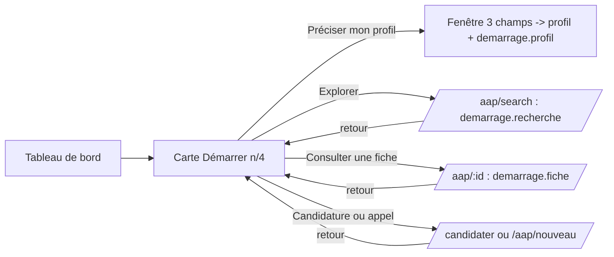

# Design

## Contexte

Les tableaux de bord (`PorteurDashboard`, `FinanceurDashboard`) sont statiques (compteurs à zéro). Le contexte
d'authentification expose `userProfile` (document `users`) et `refreshUserProfile`. Le propriétaire peut écrire son
document `users` (règle `allow update: if isOwner`).

## Décisions

1. **État dans `users/{uid}.demarrage`** : `{ profil, recherche, fiche, candidature, appel }` booléens optionnels.
   Pourquoi pas le navigateur : l'état suit la personne ; pourquoi pas une collection à part : un seul document à lire,
   déjà chargé par le contexte.
2. **Un hook `useMarquerDemarrage(cle)`** appelé en tête des quatre pages : si un compte est connecté et que l'action
   n'est pas encore cochée, il écrit `demarrage.<cle> = true` (merge) puis rafraîchit le profil. Une ligne par page,
   aucun autre changement dans ces pages.
3. **Fonctions pures** dans `components/demarrage/demarrage.ts` : `ACTIONS_PORTEUR`, `ACTIONS_FINANCEUR`,
   `etatDemarrage(role, user)` -> `{ actions: [{ cle, libelle, faite, lien? }], faites, total, termine }` ; listes
   `OBJETS_PROJET`, `RAYONS_ACTION`.
4. **Fenêtre de profil** avec le composant `Modal` existant ; trois champs porteur écrits par `setDoc(..., { merge: true })`
   sur `porteurProfiles` (`objetsProjet`, `anneeOuverture`, `rayonAction`), deux champs financeur sur
   `financeurProfiles` (`website`, `description`, déjà dans le type). Pourquoi merge : ne pas toucher au reste du
   profil.
5. **Page Mon profil** : les trois champs porteur sont ajoutés au formulaire long (lecture et correction), comme les
   champs du point 1.

## Flux

## Risques

- « Consulter une fiche » n'a pas de cible précise : le lien ouvre la recherche, la première fiche ouverte coche
  l'action. Accepté (même comportement chez helloDarwin).
- La session ne joue pas les parcours connectés : preuve limitée aux tests, au lint, au build et au rendu sans compte.
