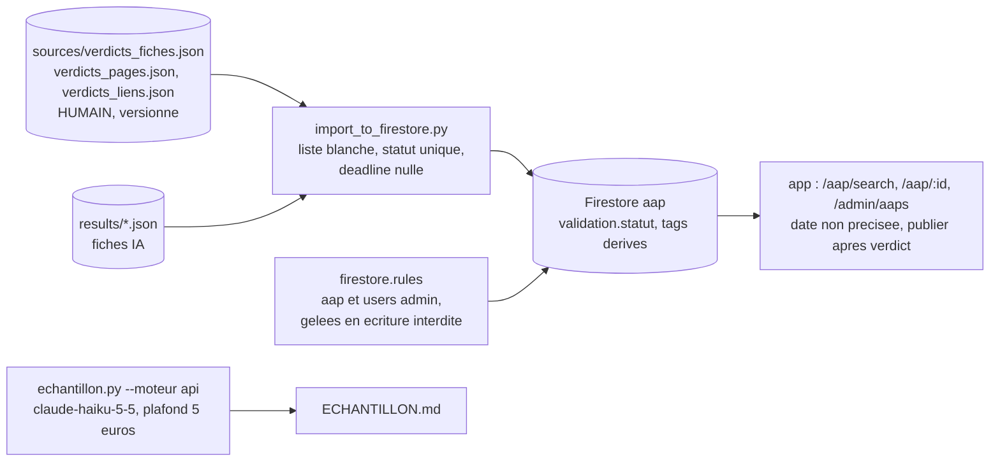

# Design

## Context

Le rapport du 2026-10-14 (section 6, instructions 1 à 9 et 17) s'applique tel quel. Ce document fixe seulement
la manière de le faire et les points que le rapport laisse ouverts, trouvés en lisant le code le 2026-10-14.

Modules gelés (instruction 1), définis par fichiers : `app/src/pages/porteur/{PorteurDashboard, ApplicationFormPage,
MyApplicationsPage, SavedSearchesPage, RecommendationsPage}.tsx`, `app/src/pages/financeur/*`, `app/src/pages/common/*`,
`app/src/pages/subscription/*`, `app/src/pages/profile/*`, `app/src/pages/admin/GlobalStatisticsPage.tsx`,
`app/src/components/guards/SubscriptionGuard.tsx`, `app/src/config/stripe.ts`, `app/functions/`, `app/storage.rules`,
et `app/src/pages/auth/SignupPage.tsx` (inscription, volet comptes). `SearchAapPage.tsx` et `AapDetailPage.tsx` sont la
consultation publique (module `app-consultation` du rapport), pas le module porteur.

Constats d'exécution (2026-10-14) : l'émulateur Firestore exige un JDK 21 (la CLI Firebase refuse Java 11 ; un
Temurin 21 est installé sur le poste, placé en tête du PATH pour la commande) ; `vitest` 5 exige Vite 6, donc `vitest` 2
et `@firebase/rules-unit-testing` 3.0.4 (firebase 10) ; `anthropic` et `python-dotenv`, déclarés dans
`scraping/requirements.txt`, manquaient dans `.venv` et ont été installés.

## Decisions

### Décision 1 : routage réduit et inscription fermée (instruction 2)

Routes conservées : `/`, `/login`, `/aap/search`, `/aap/:aapId`, `/admin`, `/admin/aaps`, `/admin/utilisateurs`,
`*` (404). Conservées aussi, hors liste du rapport : `/cgu`, `/confidentialite`, `/mentions-legales` (gabarits
« en cours de développement », cibles des liens du pied de page, ni module gelé ni inscription)
`[A VALIDER - Monsieur DUCOUT]`. Retirées : `/signup`, `/complete-profile`, `/abonnement/*`, `/dashboard/*`,
`/aap/:aapId/candidater`, `/mes-candidatures`, `/mes-aap`, `/aap/nouveau`, `/aap/:aapId/edit`,
`/aap/:aapId/candidatures`, `/aap/:aapId/candidature/:applicationId/evaluer`, `/recherches-sauvegardees`,
`/recommandations`, `/profil`, `/calendrier`, `/messages`, `/notifications`, `/statistiques`, `/admin/statistiques`,
`/admin/paiements`, `/admin/parametres`. Les imports correspondants quittent `App.tsx` (`noUnusedLocals`) ;
`SubscriptionGuard` n'est plus importé. Les huit liens vers `/signup` (sept sur l'accueil, un sur la connexion)
sont retirés : un lien public vers une page 404 contredit « inscription fermée » ; alternative : les rediriger vers
`/aap/search` avec le libellé « Consulter les appels » `[A VALIDER - Monsieur DUCOUT]`. Conséquences acceptées :
après connexion, un compte porteur ou financeur est renvoyé vers un tableau de bord retiré, donc vers la 404 ;
le bouton « Candidater » de la fiche renvoie un porteur connecté vers la 404 (un visiteur reste envoyé vers la
connexion). Aucun compte de ce type n'est attendu ; l'administrateur garde `/admin`.

### Décision 2 : `validation.statut`, seule source de fiabilité (instructions 3 et 4)

L'étiquette `a-verifier` est posée par l'import si et seulement si `validation.statut` vaut `proposee` ou
`a_corriger`, quel que soit le moteur. Conséquence visible : les fiches des connecteurs sans verdict (44 publiées
aujourd'hui sans badge) porteront « À vérifier » jusqu'à un verdict ; c'est cohérent avec le critère du lot 1
« 0 fiche publiée sans verdict ni mention ». `scrape_metadata.a_relire` n'est lu nulle part dans l'import
(vérifié : seul `extraction_locale.py --bilan` le compte) ; il reste une donnée de production du modèle local,
sans effet sur la base. `validation.par` : « Monsieur DUCOUT » quand un verdict existe, « import (date absente) »
pour le `a_corriger` posé automatiquement, chaîne vide pour `proposee`.

### Décision 3 : type `AAP` et fichiers gelés (instructions 4 et 9)

`deadline: Timestamp | Date | null` et `validation?: { statut; commentaire; date; par }` dans `app/src/types/index.ts`.
Trois fichiers gelés appellent `aap.deadline.toDate()` (`CalendarPage.tsx` lignes 56 et 85,
`RecommendationsPage.tsx` lignes 125 et 140, `MyAapPage.tsx` ligne 184) : `tsc` signalera « possibly null » et
`npm run build` échouera. Deux options : (a) un garde d'une ligne dans chacun, qui contredit le critère de
l'instruction 1 ; (b) exclure ces trois fichiers de la compilation dans `tsconfig.json` (`exclude`), possible parce
que plus rien ne les importe après la décision 1, et qui rend le gel visible dans la configuration ; l'erreur
ressortira au lot 4 quand les routes reviendront. Option recommandée : (b) `[A VALIDER - Monsieur DUCOUT]`.

### Décision 4 : import strict (instruction 5)

Trois listes exhaustives dans `import_to_firestore.py` : `CHAMPS_HUMAINS` (existants), `CHAMPS_METIER`
(existants) et `CHAMPS_TECHNIQUES` (`financeurId`, `financeurName`, `sectorsTargeted`, `externalUrl`, `source`,
`scrapeMetadata`, `views`, `applicationsCount`, `createdAt`, `updatedAt`). Le document envoyé doit avoir toutes ses
clés dans l'union ; sinon `verifier_champs` lève `ChampInconnu` avec le nom du champ et l'import, à blanc ou
réel, s'arrête avant toute écriture. Côté entrée, les clés d'une fiche lue doivent appartenir aux champs de
`AapNormalized` (`scraping/schema.py`, importé) ; même sanction. Pourquoi deux contrôles : la sortie protège la
base, l'entrée signale un connecteur qui a changé de schéma.

### Décision 5 : faux Firestore pour les cinq tests de l'audit (instruction 6)

La boucle d'écriture de `main()` devient `ecrire_documents(col, nouveau_batch, mapped, now)` ; `col.document(id)`,
`ref.get().exists`, `batch.set(ref, doc, merge=True)`, `batch.commit()` sont les seuls appels utilisés, reproduits
par deux petites classes dans `scripts/tests/`. Les tests portent le nom de la règle : « un document archivé reste
archivé après réimport », « un verdict validee protège les champs métier », « un verdict rejetee empêche la
publication » (pas de `publishedAt`, `status: archived`), « url_validee n'est jamais écrite par annuaires.py ni
registre.py » (test comportemental sur `annuaires.integrer` et `registre.sauver` avec une entrée portant
`url_validee`, plus lecture du code source des deux modules sans affectation du champ), « deux moteurs, un seul
document pour un même url_source » (`identifiant` et `fusionner`). L'ordre « verdict humain > connecteur > modèle
local » est déjà en place (`appliquer_verdict` après `fusionner`) et couvert par ces tests ; le test à trois fiches
de l'instruction 13 reste au lot 1.

### Décision 6 : verdicts humains dans `sources/` (instruction 7)

Nouveaux chemins : `scraping/sources/verdicts_pages.json` (clé = adresse de la page gardée, inchangée : le
rattachement à l'émetteur est l'instruction 19, lot 3) et `scraping/sources/verdicts_liens.json`. Option
`validation.py --migrer-verdicts [--dry-run]` : copie les deux fichiers dans `scripts/sauvegardes/verdicts_<date>/`,
affiche les comptes, écrit les nouveaux fichiers sans écraser un verdict existant, renomme les anciens en
`.json.migre`. `--appliquer-pages` ne doit plus être exécuté pour de vrai (REPRISE.md : une seule fois, verdicts
indexés par l'ancienne adresse) ; il reçoit une option `--dry-run` qui calcule le bilan sans écrire, et c'est ce
bilan, identique avant et après migration, qui sert de preuve. Les quatre `validation_*.cmd` sont mis à jour.

### Décision 7 : règles Firestore (instruction 8)

`aap` : lecture si `published`, ou administrateur, ou compte authentifié avec abonnement ; création, mise à jour,
suppression : administrateur seulement (la création par un financeur relève du module gelé ; l'import passe par le
SDK admin, hors règles). `users` : lecture propriétaire ou admin (inchangé) ; création par le propriétaire
seulement ; mise à jour propriétaire ou admin (suspendre et activer écrivent `subscriptionStatus`) ; suppression
inchangée. Collections gelées (`porteurProfiles`, `financeurProfiles`, `applications`, `savedSearches`,
`favoriteAap`, `notifications`, `messages`, `payments`, `analytics`) : `allow write: if false`, lectures inchangées.
Tests : `@firebase/rules-unit-testing` et `vitest` en dépendances de développement, fichier
`app/tests/rules/firestore.rules.test.ts`, script `npm run test:rules` = `firebase emulators:exec --only firestore
--project demo-aap "npx vitest run tests/rules"`. Java 11 est installé ; la version minimale exigée par l'émulateur
est vérifiée à l'exécution. Déploiement : `firebase deploy --only firestore:rules --project aapi-11bc3`, après
accord écrit.

### Décision 8 : échéance nulle (instruction 9)

Import : `sans_date_en_attente` écrit `deadline: None` (le SDK admin Python écrit `null`), `status: draft`,
`validation.statut: a_corriger`, étiquette `sans-date-cloture` ; l'essai à blanc affiche « clôture non précisée ».
Application : `getDaysUntilDeadline` accepte `null` et renvoie `null` ; `isClosed(null)` est faux ; `deadlineLabel`
renvoie « Date de clôture non précisée » ; la liste de recherche garde l'ordre actuel (publication décroissante)
et place les appels sans date après les datés (tri stable) ; la fiche n'affiche jamais « Clôturé » ni l'alerte
d'urgence pour une date nulle ; l'administration affiche « Non précisée » et n'offre « Publier » que si
`validation.statut` n'est ni `proposee` ni `a_corriger` (un AAP sans bloc `validation`, saisi à la main, garde le
bouton). Migration : `scripts/migrer_echeances.py` sauvegarde en JSON les documents portant `sans-date-cloture`,
affiche le compte à blanc, puis écrit `deadline: null` sur chacun ; environ 149 documents attendus.
Vérification visuelle : une fiche sans date est un brouillon, invisible sur `/aap/search` ; le contrôle se fait sur
`/admin/aaps` et sur `/aap/:id` connecté en administrateur ; publier temporairement une fiche sans date pour voir
`/aap/search` demanderait l'accord de Monsieur DUCOUT. `docs/application_spec.json` : contrainte « deadline
obligatoire » remplacée ; mention « à confirmer » de la règle du 2026-10-14 retirée dans le CDC et la spécification
(réponse Q6).

### Décision 9 : mesure d'un modèle API sur l'échantillon (instruction 17)

Modèle : `claude-haiku-5-5`, le modèle Anthropic le moins cher en service, plus petit que Sonnet. Prix vérifiés le
2026-10-14 sur la page officielle des tarifs (`platform.claude.com/docs/en/about-claude/pricing`, lue dans la
session) : 0,10 USD par million de tokens en entrée et 0,50 USD en sortie pour une requête de 100 000 tokens au
plus (0,50 et 2,50 au-delà, jamais atteint : les textes sont bornés à 80 000 caractères, soit environ 20 000 tokens) ;
écriture en cache 0,125 USD, lecture en cache 0,01 USD. Pour comparaison : Sonnet 4.6 (modèle des connecteurs)
3 USD et 15 USD ; Sonnet 5.5 2 USD et 10 USD.
Volume mesuré dans la session : 45 textes (24 fiches de référence et 21 pages hors sujet), 173 676 caractères, soit
environ 43 400 tokens d'entrée, envoyés deux fois (question fermée « est-ce un appel ? » puis extraction, pour
rester comparable au protocole Ollama) ; sortie estimée 1 662 tokens par fiche (moyenne constatée sur 363
extractions Sonnet) plus 200 par question. Coût estimé : 0,05 USD, soit 0,05 euro ; avec 30 % de tokens de plus
(nouveau découpage des modèles récents), moins de 0,10 euro. Marge : cinquante fois sous le plafond.
Mécanisme : `extractor.py` reçoit un paramètre `model` et une table de prix par modèle (le journal
`logs/extraction_costs.jsonl` reste exact), plus une fonction de question fermée avec un petit outil `est_aap` ;
`echantillon.py --extraire --moteur api --modele claude-haiku-5-5` ne lit que les 45 textes de l'échantillon
(adresses de la référence et des pages hors sujet), écrit `results/echantillon_api_claude-haiku-5-5.json`
(plus `_non_aap.json` et `.errors.json`), additionne le coût du modèle depuis le journal et s'arrête avant le
texte qui ferait dépasser le plafond (`--plafond`, 5 euros par défaut, cumulé sur toutes les exécutions du modèle).
`--controler --moteur api` remplit la grille sous la clé `api_claude-haiku-5-5` ; `--rapport` inclut les sorties
`echantillon_api_*` et le coût réel lu dans le journal. Points vérifiés dans la référence des modèles : l'usage
forcé d'un outil est accepté par ce modèle ; aucun paramètre de température n'est envoyé (refusé) ; les blocs
de réponse sont lus par type. Déroulement : code et tests sans appel, accord écrit, un texte (`--limite 1`), coût
lu, puis les 44 autres. Une seconde mesure avec `claude-sonnet-5-5` (estimée 0,93 euro) n'aurait lieu que sur un
nouvel accord et dans le même plafond cumulé.
Résultat (2026-10-14, accord donné, budget accepté jusqu'à 10 dollars, plafond conservé à 5 euros) : 40 textes
traités pour 45 adresses : les 5 textes FIRAH « appel-a-projets-general » 2021 à 2025 de la référence existent dans
`decouverte/firah/fiches/` mais la rubrique FIRAH, redécouverte le 13 octobre avec 2 liens d'AAP, n'est plus retenue
par `choisir_rubriques` (une rubrique par famille, celle qui a le plus de liens : Fondation de France, 20) ; 16 fiches, 14 justes sur
15 comparées à cette première passe. Sur accord de Monsieur DUCOUT le même jour, `fiches_par_adresse` lit les textes de
l'échantillon par adresse dans toutes les rubriques découvertes et les 5 textes FIRAH ont été mesurés. Résultat final :
45 textes, 21 fiches (20 de la référence, 1 page hors sujet extraite à tort), 24 refus à la question fermée dont 4 à
tort (pages Interreg présentant un appel clos avec ses résultats, bourses SFMU) ; contrôle : 19 justes sur 20
comparées, 1 fabriquée, seuil 20/2 manqué d'une fiche ; coût réel 0,028 euro pour 66 appels (157 s), soit environ
0,0006 euro par texte. Estimation dérivée, non mesurée : environ 2 euros pour les 3 748 liens au même coût moyen par
texte.

### Décision 10 : configuration ESLint absente

`npm run lint` échoue au départ parce qu'aucun fichier de configuration ESLint n'existe dans `app/` (ESLint 8.57.1,
message « couldn't find a configuration file »). Un `.eslintrc.cjs` standard du gabarit Vite React TypeScript est
créé (règles `@typescript-eslint/recommended`, `react-hooks`, `react-refresh`, déjà installées), `dist` et
`functions` ignorés. Si des erreurs ressortent dans des fichiers gelés, ils sont ajoutés à `ignorePatterns`
plutôt que corrigés `[A VALIDER - Monsieur DUCOUT]`.

## Risks / Trade-offs

- Le badge « À vérifier » apparaît sur 44 fiches de connecteurs : perte apparente de confiance, gain de sincérité.
- Exclure trois fichiers gelés de `tsc` cache leurs erreurs jusqu'au lot 4 ; alternative : les corriger (une
  ligne chacun) en dérogeant à l'instruction 1.
- L'émulateur Firestore peut exiger une version de Java plus récente que celle installée ; constat à l'exécution.
- La mesure API dépend d'un crédit disponible sur le compte Anthropic ; un refus de facturation est rapporté tel quel.
