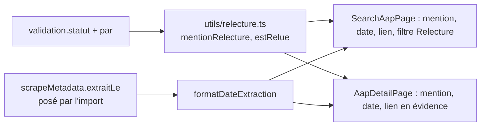

# Design

## Contexte

`validation.statut` est la seule source de fiabilité d'une fiche (lot 0, instruction 3) ; `validation.par` dit qui a
tranché : « Monsieur DUCOUT », un modèle (`claude-haiku-5-5` depuis le 2026-10-15), ou l'import (« import (champ) »).
L'application n'exploite aujourd'hui que l'étiquette `a-verifier` des tags.

## Décisions

1. **Une fonction pure partagée** plutôt que deux conditions dans deux pages : la règle d'affichage suit la règle de
   fiabilité et se teste en un endroit.
2. **Trois mentions seulement**, en français courant, sans jargon de statut : relue (humain), contrôlée par le modèle,
   non relue. « Rejetée » n'apparaît pas : une fiche rejetée est archivée, donc jamais publiée.
3. **`extraitLe` plutôt que `importedAt`** : la date d'import existe déjà mais c'est celle du robot d'import, pas celle de
   la lecture de la page ; `produite_le` et `scraped_at` disent quand le texte a été lu par le moteur.
4. **Le filtre « relues seulement » garde les fiches validées par le modèle** : décision du 2026-10-15, le contrôle vaut
   relecture ; le libellé « relues ou contrôlées » le dit au visiteur.
5. **Lien officiel dans la liste** avec arrêt de la propagation du clic, pour ne pas ouvrir la fiche.

## Risques

- Fiches des connecteurs closes et non contrôlées (31 au 2026-10-19) : elles afficheront « Non relue », ce qui est
  exact.
- Le ré-import pose `extraitLe` sur tous les documents : champ technique de `scrapeMetadata`, jamais un champ humain ;
  essai à blanc avant.
