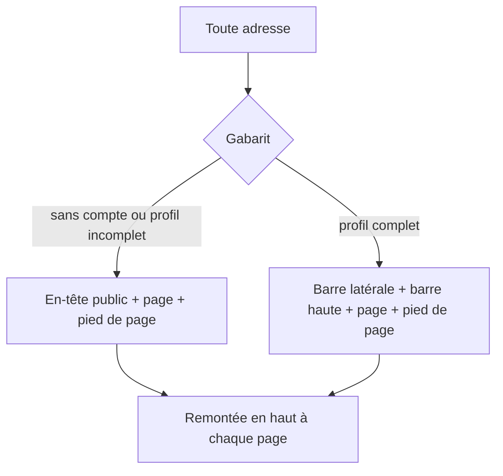

# Design

## Contexte

Chaque page porte aujourd'hui son propre fond `min-h-screen bg-gray-50` et, pour quatre d'entre elles (accueil,
tableaux de bord, Mes appels), son propre en-tête. Les routes sont déclarées à plat dans `App.tsx`. Les pages légales
ont un gabarit `LegalLayout` avec un lien « Retour à l'accueil » en haut.

## Décisions

1. **Une route parente `Gabarit`** (`<Route element={<Gabarit />}>` avec `Outlet`) qui enveloppe toutes les routes.
   Il choisit entre deux habillages d'après le contexte d'authentification : public (en-tête + contenu + pied de page)
   ou connecté avec profil complet (barre latérale + barre haute + contenu + pied de page). Pourquoi d'après
   `profileComplete` : pendant le parcours d'intégration, le menu complet n'a pas de sens.
2. **Entrées de menu dans `components/layout/menus.ts`** (`entreesMenu(role)` -> sections avec libellé, adresse,
   icône) : testable, et c'est la seule table à modifier pour ajouter une page.
3. **Repli de la barre** mémorisé dans `localStorage` (`aap-menu-replie`), lecture protégée par try/catch.
4. **Remontée en haut** : composant `RemonterEnHaut` qui appelle `window.scrollTo(0, 0)` à chaque changement de
   `pathname`.
5. **Retour** : `navigate(-1)` si l'historique a plus d'une entrée, sinon vers l'accueil (ou le tableau de bord quand
   connecté).
6. **Pages connectées** : leurs en-têtes locaux (tableaux de bord) sont retirés pour ne pas doubler la barre haute ;
   leur fond `bg-gray-50` est conservé (le contenu occupe la colonne principale).
7. **Offres** : `GrilleOffres` sort du parcours d'intégration pour servir aussi la page Tarifs ; même source de
   montants (`config/stripe.ts`), toujours à valider.
8. **Contact** : document `messagesContact/{id}` (sujet, message, e-mail facultatif, date) ; règle `allow create: if
   true` limitée aux trois champs, lecture administrateur ; pas de fonction serveur.

## Flux

## Risques

- Les pages connectées ont été écrites pleine largeur ; avec la barre latérale, certaines grilles à quatre colonnes
  peuvent se resserrer. Vérification visuelle par Monsieur DUCOUT, ajustements au cas par cas.
- La règle Firestore de `messagesContact` n'est pas déployée par la session : le formulaire de contact échoue avec un
  message clair tant que Monsieur DUCOUT n'a pas donné son accord pour le déploiement.
