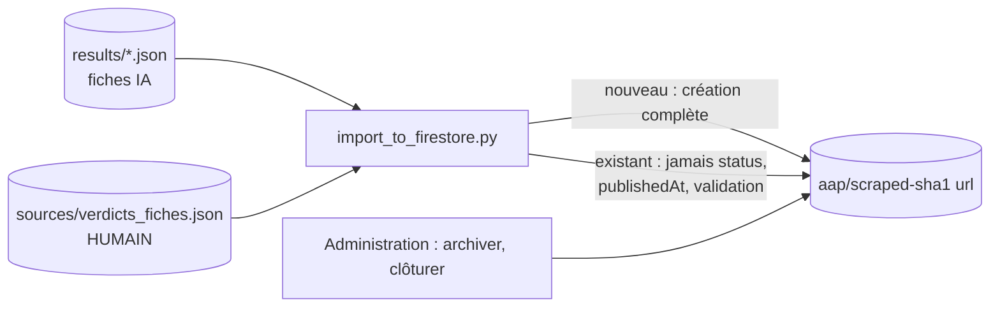

# Design

## Context

Aujourd'hui `scripts/import_to_firestore.py` construit un document complet à partir de la fiche et l'écrit
avec `set(merge=True)` sous `scraped-<signature>`. Les décisions humaines vivent dans trois endroits sans
lien : `results/validation_manuelle.json` (jamais lu), l'écran d'administration (statut, écrasé au lot
suivant), `sources/registre.json` (adresse corrigée indistincte).

## Decisions

### Décision 1 : identifiant dérivé de l'adresse de l'appel

`scraped-<sha1(url_source normalisée)[:16]>`. L'adresse est brute, stable et identique quel que soit le
moteur. Normalisation : minuscules sur le domaine, suppression du fragment `#...` et de la barre finale.
`signature` reste écrite comme attribut (compatibilité avec le cache des connecteurs). Les 221 documents
actuels sont supprimés puis recréés : accepté par Monsieur DUCOUT, aucun utilisateur.

### Décision 2 : champs protégés sur un document existant

Liste explicite `CHAMPS_HUMAINS = ("status", "publishedAt", "validation")`, retirés du document envoyé
quand le document existe déjà. Pourquoi une liste plutôt qu'un sous-objet `proposition` : l'application lit
les champs à plat (`title`, `deadline`...) et les règles Firestore filtrent sur `status` ; changer la forme
du document toucherait toutes les pages. La liste protège sans rien casser ; la restructuration reste
possible plus tard.

### Décision 3 : les verdicts pilotent l'import

Fichier `sources/verdicts_fiches.json`, clé = adresse de l'appel, valeur = `{verdict, commentaire, date}`
(forme actuelle de `validation_manuelle.json`, inchangée pour que `validation.py` continue d'écrire pareil).
Correspondance : `pas-un-aap` -> `status: archived` à la création et `validation.statut: rejetee` ;
`aap-juste` -> `validation.statut: validee`, étiquette `a-verifier` retirée, et sur un document existant les
champs métier (`title`, `description`, `deadline`, budgets, `eligibilityCriteria`, `requiredDocuments`) ne sont
plus réécrits ; `aap-a-corriger` -> `validation.statut: a_corriger`, étiquette gardée, `validation.commentaire`
porté. Sans verdict : `validation.statut: proposee`. Le fichier est versionné et jamais écrit par un outil
automatique : il vit dans `sources/` comme `relecture_qualification.json`.

### Décision 4 : fiches sans date de clôture en attente

Importées avec `status: draft` (les règles Firestore les cachent aux visiteurs sans abonnement), échéance
fictive à un an et étiquette `sans-date-cloture` (mécanisme existant), `validation.statut: a_corriger`. Elles
apparaissent dans le raccourci de validation ; un verdict `aap-juste` avec une date dans le commentaire sera
traité au changement suivant.

### Décision 5 : adresse validée dans le registre

`url_validee`, `validee_par`, `validee_le` à côté de `url_aap`. `registre.adresse_aap(source)` renvoie
`url_validee or url_aap` ; `decouverte.py`, `registre.py --verifier-pages`, `validation.py --liens` l'utilisent.
`annuaires.py --integrer` ne touche jamais une entrée existante. Migration : pour chaque note « Adresse
corrigée par Monsieur DUCOUT le D (ancienne : A) », `url_validee = url_aap`, `url_aap = A`, `validee_le = D`.

## Risks / Trade-offs

- [Documents recréés : vues et compteurs perdus] -> acceptés, aucun utilisateur ; sauvegarde JSON des 221
  documents avant suppression.
- [Un verdict donné sur l'ancienne clé d'adresse] -> la clé est `url_source`, inchangée par ce changement.
- [Protection trop large : une correction légitime de l'IA n'arrive plus sur une fiche validée] -> voulu : une
  fiche validée ne bouge que par un nouveau verdict humain.
