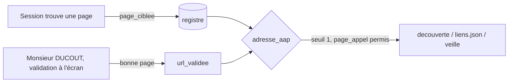

# Design

## Contexte

Trois réglages dépendent aujourd'hui de `url_validee` :

| Endroit | Effet de `url_validee` |
|---|---|
| `registre.adresse_aap` | adresse de départ de la découverte, du contrôle des pages et de la vue lisible |
| `decouverte.reglages` | seuil d'un lien d'appel au lieu de deux, écrit dans `liens.json` pour la veille |
| `registre.erreurs_format` | `page_appel: true` refusé sans elle |

Le champ veut dire deux choses : « page validée par Monsieur DUCOUT » et « page à lire avec un seul lien ». Le
changement sépare les deux : la lecture accepte aussi une page ciblée par une session, la validation reste à lui.

## Décisions

1. **Un champ qui porte l'adresse, pas un drapeau.** `page_ciblee` contient l'adresse. Avec un simple drapeau, il
   faudrait réécrire `url_aap` (l'adresse d'origine) pour les 7 sources dont la page diffère ; le champ séparé laisse
   `url_aap` intact, comme `url_validee` le fait déjà.
2. **Ordre de priorité `url_validee` > `page_ciblee` > `url_aap`.** La parole de Monsieur DUCOUT l'emporte toujours ;
   une page ciblée ne remplace jamais une adresse qu'il a validée.
3. **Confirmation dans l'outil existant.** `validation.py --appliquer-pages` traite déjà ses verdicts par page. Le
   verdict « bonne page » promeut la page ciblée en `url_validee` ; « mauvaise page » avec adresse écrit déjà
   `url_validee` et retire désormais la page ciblée. Aucun nouvel écran.
4. **Migration par un script à usage unique (dossier temporaire de la session), essai à blanc d'abord.** Le registre
   est versionné : le diff Git de `registre.json` est la preuve rejouable. Sélection exacte : `validee_le` =
   2026-10-28 et « lot B1 » dans `validee_par` (47 sources mesurées).
5. **Les `liens.json` ne sont pas réécrits.** Les réglages calculés après migration sont identiques ; la tâche 3.2 le
   prouve source par source.

## Risques

- Une page ciblée mal choisie est lue avec un seul lien : c'est déjà le cas aujourd'hui avec `url_validee` posée par la
  session ; la file « à valider » de l'administration reste le filet (fiches importées en « Proposée, non relue »).
