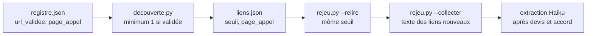

# Design

## Contexte

`decouverte.choisir_rubrique` ne retient une page que si elle contient au moins deux liens d'appel. La veille
(`rejeu.relire_source`) appelle la même fonction : une page validée qui n'affiche qu'un appel est ignorée à chaque
passage (« aucun lien d'appel lisible (moins de deux) »). Une page qui est elle-même l'appel n'a aucun lien d'appel,
donc n'est jamais retenue.

## Décisions

1. **Le seuil devient un paramètre** `minimum` de `choisir_rubrique` (défaut 2). La découverte passe 1 quand la source a
   une `url_validee`. Pourquoi ce critère : `url_validee` n'est écrit que par une validation humaine (relecture à
   l'écran ou adresse donnée par Monsieur DUCOUT), c'est donc la seule preuve existante que la page est la bonne.
2. **`page_appel: true`** ajoute la page elle-même en tête des liens retenus (`texte` = titre de la page, `score` = 3).
   Pourquoi un champ explicite plutôt qu'une règle automatique (« page validée sans lien = appel ») : une page de liste
   validée peut être vide entre deux campagnes ; la prendre pour un appel enverrait son texte au modèle pour rien.
3. **La veille lit ces deux réglages dans `liens.json`** (`seuil`, `page_appel`), écrits par la découverte. Pourquoi :
   la veille travaille déjà à partir de `liens.json` et pas du registre ; elle reste indépendante du registre.
4. Le contrôle de format du registre vérifie `page_appel` (booléen, et seulement avec `url_validee`).

## Risques

- Une page validée qui ne contient qu'un lien hors sujet (« appel à communication ») serait retenue : le texte collecté
  passe ensuite par la question fermée de l'extraction, qui refuse les pages qui ne sont pas des appels.
- Une page d'appel annuelle change d'adresse l'année suivante (Tubbe 2027) : la veille la verra en erreur ou inchangée ;
  la recherche de la nouvelle adresse reste humaine.
