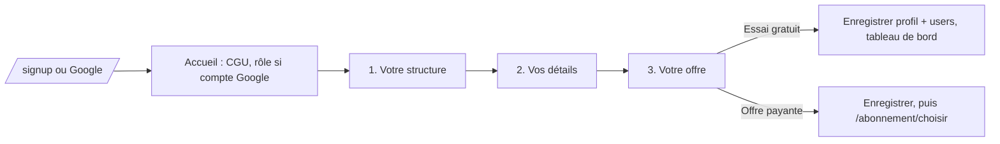

# Design

## Contexte

`CompleteProfile.tsx` aiguille vers `CompletePorteurProfile` ou `CompleteFinanceurProfile`, deux pages longues qui
servent aussi, depuis le 2026-10-20, de formulaires d'édition sur `/profil` (propriété `profilExistant`). Le compte
Google n'a pas de document `users` (seul `signup` le crée), donc `userProfile` est nul et la page affiche une erreur.
La page des offres `SelectPlanPage` gère déjà Stripe (non branché) et un bouton « Continuer avec la période d'essai ».

## Décisions

1. **Une page de parcours nouvelle, les formulaires longs gardés pour l'édition.** `ParcoursIntegrationPage` ne
   remplace pas `CompletePorteurProfile` : celui-ci reste le formulaire complet de « Mon profil » (SIRET, site,
   description, téléphone...). Pourquoi : le parcours ne pose que l'essentiel (helloDarwin : trois écrans), le reste se
   complète plus tard ; réécrire les formulaires longs en étapes aurait touché 600 lignes qui fonctionnent.
2. **Fonctions pures dans `pages/onboarding/parcours.ts`** : listes (`FORMES_JURIDIQUES`, `TYPES_ETABLISSEMENT`
   groupés, `TAILLES`, `BUDGETS`, `PUBLICS`), `regionDepuisCodePostal`, `etapeComplete`, `profilPorteurDepuisParcours`,
   `profilFinanceurDepuisParcours`. Pourquoi : testables sans React ni Firebase.
3. **Région d'après le département** : les deux premiers caractères du code postal (20 -> Corse, 97x -> département
   d'outre-mer sur trois caractères) donnent le département, une table département -> identifiant de région (les mêmes
   identifiants que `utils/territoires.ts`, donc que l'import) donne la région. Pourquoi : pas d'appel réseau, et la
   région enregistrée est directement comparable aux territoires des fiches pour le point 3.
4. **Création du document utilisateur réutilisable** : la construction du document `users` sort de `signup` vers une
   méthode `creerDocumentUtilisateur(userType)` du contexte, appelée par `signup` et par la fin du parcours quand le
   document manque (compte Google). Pourquoi : une seule définition de l'essai de 14 jours.
5. **Champs du profil porteur** : `structureType` passe à `string` dans le type (les anciennes valeurs restent
   valides), quatre champs optionnels ajoutés ; `secteurActivite` est écrit « sante » par le parcours (tout compte ici
   relève de la santé) et `domainesIntervention` vide, pour rester compatible avec la page des recommandations qui lit
   ces deux champs. Pourquoi : aucune migration, aucun profil existant cassé.
6. **Offres** : montants lus dans `config/stripe.ts` (29,99 / 299,99 porteur, 99,99 / 999,99 financeur), affichés
   dans le gabarit avec la mention « 2 mois offerts » ; Monsieur DUCOUT a demandé des « valeurs à valider dans le
   gabarit ». Le bouton payant enregistre puis renvoie vers `/abonnement/choisir`, qui porte déjà l'appel Stripe.
7. **CGU** : la case d'accueil écrit `cguAccepteLe` (horodatage) dans `users` à la fin du parcours. Pourquoi : trace
   RGPD de l'acceptation, qui manquait pour les comptes Google.

## Flux

## Risques

- La session ne joue pas le parcours sur le vrai projet Firebase (aucun compte créé par la session) : la preuve se
  limite aux tests Vitest, au lint, à la compilation et à l'affichage de l'écran d'accueil sans compte (redirection
  vers `/login`). Monsieur DUCOUT joue le parcours avec un compte de test neuf.
- La page des recommandations suppose `domainesIntervention` et `teamSize` ; un profil issu du parcours les laisse
  vides, la page retombe alors sur ses valeurs par défaut (comportement existant).
