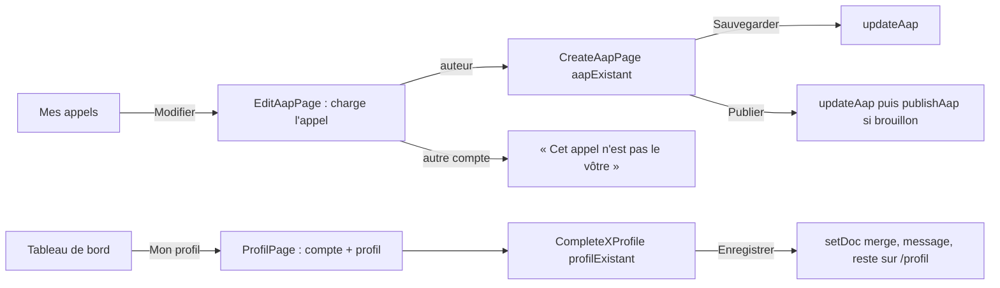

# Design

## Contexte

Les quatre pages vides sont des `PlaceholderPage` dans `App.tsx`. Les formulaires de profil
(`CompletePorteurProfile`, `CompleteFinanceurProfile`) et le formulaire d'appel (`CreateAapPage`, cinq étapes)
existent et fonctionnent en création ; ils partent toujours d'un formulaire vide et redirigent après enregistrement.
`aapService.updateAap` existe et n'est utilisé nulle part. Les règles Firestore déployées le 2026-10-19 autorisent
le propriétaire à écrire son profil et l'auteur à modifier son appel.

## Décisions

1. **Un mode « édition » dans les formulaires existants, pas de nouveaux formulaires.** Une propriété optionnelle
   `profilExistant` (profils) ou `aapExistant` (appel) pré-remplit l'état initial ; l'enregistrement et la
   redirection changent selon sa présence. Pourquoi : les champs et leurs contrôles restent uniques ; une correction
   future se fait à un seul endroit.
2. **Fonctions pures dans des fichiers sans Firebase** : `pages/financeur/aapFormulaire.ts`
   (`formulaireDepuisAap`, `donneesDepuisFormulaire`, `FORMULAIRE_VIDE`) et `pages/profile/profilFormulaire.ts`
   (`formulairePorteurDepuisProfil`, `formulaireFinanceurDepuisProfil`). Pourquoi : testables par Vitest sans monter
   React ni Firebase ; `donneesDepuisFormulaire` remplace les deux copies identiques de la construction des données
   dans `CreateAapPage` (sauvegarde et publication), copies que le mode édition aurait portées à quatre.
3. **Pages d'entrée minces** : `ProfilPage` charge `users` (déjà dans le contexte) et le document de profil, affiche
   l'en-tête du compte, puis le formulaire en mode édition ; `EditAapPage` charge l'appel par `aapService.getAapById`,
   vérifie `financeurId === currentUser.uid`, puis rend `CreateAapPage` avec `aapExistant`. Pourquoi : la vérification
   d'auteur se lit en trois lignes au lieu d'être diluée dans un formulaire de 500 lignes.
4. **Publication depuis l'édition** : `updateAap` puis `publishAap` seulement si le statut était `draft`. Pourquoi :
   `publishAap` réécrit `publishedAt` ; un appel déjà publié doit garder sa date de publication (scénario de la spec).
5. **Logo du financeur en édition** : sans nouveau fichier, le logo enregistré est conservé (`logo` inchangé). Le
   téléversement reste tel quel (Storage inactif sans Blaze : erreur existante, hors périmètre).
6. **Dates** : la date de clôture est convertie en `aaaa-mm-jj` pour le champ de date via `utils/dates.ts enDate`
   (déjà présent), vide si nulle.

## Flux

## Risques

- Les champs de date du navigateur refusent une valeur antérieure à `min` (aujourd'hui) : un appel dont la clôture est
  passée garde sa date affichée mais le navigateur peut la signaler ; la validation de l'étape ne regarde que la
  présence d'une date. Accepté, à observer lors des parcours de Monsieur DUCOUT.
- La session ne joue pas les parcours connectés sur le vrai projet (règle du 2026-10-19) : la preuve de la session se
  limite aux tests Vitest, au lint, à la compilation et au rendu sans compte (redirection vers `/login`).
