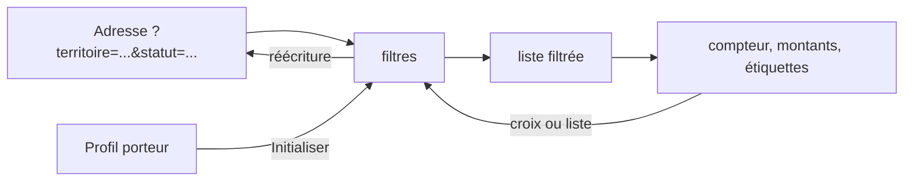

# Design

## Contexte

`SearchAapPage` charge toutes les fiches publiées, filtre en mémoire (`applyFilters`) et garde ses filtres dans un
état React local, perdu au rechargement. Les utilitaires `utils/deadline.ts` (jours restants, clôturé, sans date) et
`utils/territoires.ts` (libellés) existent.

## Décisions

1. **Fonctions pures dans `utils/recherche.ts`** : `statutAppel(aap, maintenant)` (quatre valeurs),
   `LIBELLES_STATUT`, `totalMontants(aaps)`, `etiquettesActives(filtres)`, `filtresDepuisParams`, `paramsDepuisFiltres`,
   `filtresDepuisProfil(profil)`, `memoriserFicheConsultee` / `fichesConsultees` (localStorage, protégé par try/catch).
2. **Adresse de la page comme source des filtres** : `useSearchParams` de React Router ; l'état des filtres est
   dérivé des paramètres, chaque changement réécrit l'adresse (`replace`, pas d'historique à chaque coche). Pourquoi :
   un seul état, partageable, et le bouton Retour du navigateur ramène à la recherche telle qu'elle était.
3. **Statut** : `bientot-clos` si 0 à 30 jours (le seuil 30 jours est celui de helloDarwin), `clos` si négatif,
   `sans-date` si pas de clôture, sinon `ouvert`. « Bientôt ouvert » écarté : les fiches n'ont presque jamais de date
   d'ouverture.
4. **Montant d'une fiche** : `budgetTotal` sinon `budgetMax` sinon rien ; affiché en euros entiers, format français.
5. **Territoire** : le filtre garde une fiche si elle porte le territoire choisi ou `france`, sauf quand le choix est
   `france` lui-même.
6. **Initialiser à mon profil** : lit `porteurProfiles/{uid}.address.region` au montage pour un porteur connecté ; le
   bouton n'apparaît que si une région est connue.
7. **Fiches consultées** dans `localStorage` (clé `aap-fiches-consultees`, vingt identifiants) ; l'onglet filtre les
   fiches déjà chargées par ces identifiants.

## Flux

## Risques

- Les montants annoncés additionnent des budgets de nature différente (enveloppe totale ou plafond par projet) ; le
  libellé « annoncés » et le nombre de fiches chiffrées le disent. À observer par Monsieur DUCOUT.
- Le bouton « Copier le lien » dépend de `navigator.clipboard`, absent sur certains navigateurs anciens ; message
  d'erreur dans ce cas.
