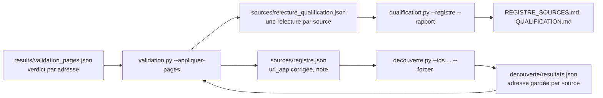

# Design

## Contexte

Deux fichiers portent la connaissance des pages : `decouverte/resultats.json` (par source, la page
gardée `url_rubrique`, hors Git) et `results/validation_pages.json` (par adresse de page, le verdict
de Monsieur DUCOUT, son commentaire, la date ; hors Git). Le registre ne connaît que `url_aap`
(page de départ) et `qualification` (verdict du modèle, éventuellement relu). Le pont entre les deux
est l'adresse de la page gardée : plusieurs sources peuvent partager la même page (deux entrées
pour Montpellier, pour la Drôme), le verdict s'applique alors à toutes.

## Flux

## Décisions

1. **Fonction pure `appliquer_verdicts_pages(verdicts, resultats, registre, relecture, date)`**,
   sans lecture ni écriture de fichier, qui renvoie la relecture complétée, les corrections
   d'adresse, les sources à redécouvrir, les sources à retrouver (page morte ou mauvaise page sans
   adresse) et les verdicts sans source. Pourquoi : testable sans les fichiers hors Git, et la règle
   « preuve avant affirmation » demande des sorties lisibles.
2. **Correspondance des verdicts** (table unique dans le code) :
   - `bonne-page` : relecture `rubrique-confirmee` si le verdict en vigueur est autre ; sinon rien
     (la source est déjà confirmée, on compte seulement).
   - `hors-champ` : relecture `hors-sante`.
   - `page-morte` : relecture `a-verifier`, source listée « à retrouver ».
   - `mauvaise-page` : première adresse http(s) du commentaire -> nouvelle `url_aap` ; ancienne
     adresse et éventuelle seconde adresse dans `notes` ; relecture `rubrique-confirmee` (c'est
     Monsieur DUCOUT qui a désigné la page) ; source à redécouvrir. Sans adresse dans le
     commentaire : relecture `a-verifier`, source « à retrouver ».
   - `passer` : ignoré.
3. **Motif et relecteur** fixés par l'outil : relecteur « Monsieur DUCOUT, validation à l'écran »,
   motif « bonne page vue à l'écran » / « adresse donnée à l'écran : ... » / « page morte à
   l'écran » / « hors champ à l'écran », suivi du commentaire s'il y en a un. Une relecture déjà
   présente pour la source est remplacée (la validation à l'écran est plus récente que la relecture
   sur texte du 2026-10-12), l'ancienne étant conservée sous `relecture_precedente`.
4. **Redécouverte** par l'outil existant (`decouverte.py --ids --forcer`), pas par un nouveau code :
   la découverte repart de la nouvelle `url_aap`, visite au plus trois candidats, garde la page qui a
   le plus de liens d'appels. Contrôle après coup : pour chaque source redécouverte, si le domaine de
   la page gardée diffère de celui de l'adresse donnée, la source est listée dans le compte rendu
   pour une nouvelle validation à l'écran (`validation_pages.cmd`).
5. **Rien n'est supprimé** : les verdicts restent dans `validation_pages.json`, la relecture
   précédente reste dans le fichier de relecture.

## Risques

- Une adresse saisie avec une faute n'est pas vérifiée par l'outil : la redécouverte l'ouvrira et
  signalera « erreur » ou « bloqué » dans `DECOUVERTE.md` ; ces sources rejoignent la liste à
  retrouver.
- Les préfectures et sites qui bloquent le robot (voir README) resteront « bloqué » à la
  redécouverte : leur adresse corrigée est quand même au registre, la page sera lue au moment de
  l'extraction par un autre moyen.
