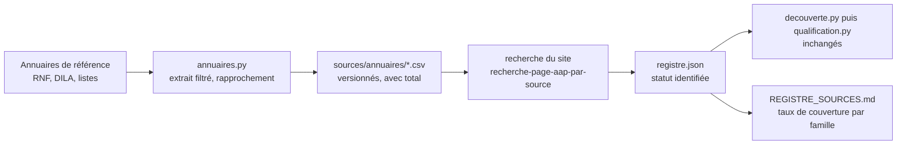

# Design

## Inventaire des familles d'émetteurs (à valider par Monsieur DUCOUT)

Toutes les familles qui peuvent financer des appels à projets, à manifestation d'intérêt ou à
candidatures en santé et médico-social. « Registre » = entrées actuelles (comptage du 2026-10-13
par mots du nom, approximatif). « Annuaire » = la liste de référence et son total quand il est
connu. Les totaux marqués (est.) sont des estimations à confirmer avec l'annuaire.

| Famille | Annuaire de référence | Total | Registre | Vague |
|---|---|---|---|---|
| Fondations reconnues d'utilité publique et d'entreprise | RNF (ministère de l'Intérieur, data.gouv.fr), état actif, domaine ou objet santé-social | 664 | 46 (toutes fondations) | 1 |
| Fonds de dotation | RNF, même filtre | 2 661 | 0 | 2 |
| Fondations abritées | annuaire de la Fondation de France (recherche interne), puis Fondation Caritas, Institut de France, Fondation du Protestantisme, Fondation de l'Avenir | inconnu (plusieurs centaines, est.) | 2 pages de liste | 2 |
| Fondations hospitalières et d'établissements, groupes privés (Elsan, Ramsay, Vivalto, Clariane) | RNF (elles y sont comme FRUP ou FE) | inclus dans 664 | 31 | 1 |
| Agences nationales de santé et de recherche (HAS, Santé publique France, ANSM, INCa, ANSES, Agence de la biomédecine, ANAP, ANRS-MIE, IReSP, Inserm, CNRS, ANR, Bpifrance, Banque des Territoires, ANCT, ANAH, ADEME) | liste fixe, vérifiée sur l'annuaire de l'administration (DILA) | environ 25 | 34 (toutes agences) | 3 : compléter la liste |
| Ministères et programmes nationaux (Santé, Solidarités, Travail, Recherche, Culture, Intérieur FIPD, Justice, DGOS) | liste fixe | environ 12 | 150 (dont préfectures) | 3 |
| ARS | DILA | 18 | 19 | fait |
| Sécurité sociale : CPAM, CAF, Carsat, MSA, CNSA, CNAV, CNAF | DILA | 101 + 101 + 16 + 35 + 3 | 99 + 95 + 17 + 42 | fait (à rapprocher) |
| Conférences des financeurs de la prévention de la perte d'autonomie | une par département, hébergées par les départements ou les ARS | 101 | 0 | 3 |
| Retraite complémentaire et prévoyance (Agirc-Arrco, institutions de prévoyance, groupes de protection sociale) | liste CTIP et Agirc-Arrco | environ 40 | 9 | 3 |
| Mutuelles | liste ACPR des organismes agréés, Mutualité Française | environ 250 (est.) | 9 | 3 |
| Régions | DILA | 18 | 3 | 3 : compléter |
| Départements | DILA | 101 | 150 (doublons) | fait (à rapprocher) |
| Métropoles, communautés urbaines, grandes villes et CCAS | DILA | 21 + 14 + villes de plus de 100 000 habitants (42) | 50 | 3 |
| État déconcentré : préfectures, DREETS, DDETS, DRAJES, DRAC (culture-santé), rectorats | DILA | 101 + 13 + 101 + 13 + 13 | 103 + 12 | 3 (préfectures bloquent le robot) |
| Europe : EU4Health, Horizon Europe, FSE+, FEDER, Interreg (programmes avec la France), Erasmus+ | portail européen Funding and Tenders (API) | environ 12 programmes | 13 | 3 |
| Sociétés savantes et conseils nationaux professionnels | liste de la Fédération des spécialités médicales | environ 47 | 18 | 3 |
| Fédérations et associations nationales qui financent (France Alzheimer, Ligue contre le cancer, ARC, AFM-Téléthon, Fédération française de cardiologie, Vaincre la mucoviscidose, APF, Unapei, Nexem, FEHAP, FHF, FHP, Uniopss et 15 Uriopss, Croix-Rouge, Fédération Addiction) | liste fixe | environ 40 | partiel | 3 |
| Recherche : cancéropôles, GIRCI, instituts Carnot santé, IHU, EIT Health | listes fixes | 7 + 7 + environ 10 + 12 + 1 | 9 | 3 |
| URPS et ordres professionnels | fédérations nationales des URPS | environ 170 URPS | 0 | 4 : vérifier qu'ils lancent des appels |
| Fonds de formation : OPCO Santé, Uniformation, ANFH | liste fixe | 3 | 0 | 3 |
| Banques coopératives à mécénat régional (caisses régionales du Crédit Agricole, fédérations du Crédit Mutuel, Caisses d'Épargne, Banques Populaires) | listes des groupes ; leurs fondations sont dans le RNF | 39 + 18 + 15 + 14 | 4 | 2 (via RNF) |
| Agrégateurs et relais : appelsaprojets.org, Admical, Directions.fr, UDAF (96 sites listés par l'UNAF), Centre français des fonds et fondations, Carenews, Aides-territoires (API, compte gratuit) | listes fixes | environ 105 | 5 | 2 |
| Collectivités à statut particulier et outre-mer (Corse, Martinique, Guyane, Nouvelle-Calédonie, Polynésie, Saint-Pierre-et-Miquelon) | DILA | 6 | partiel | 3 |

Exclues par décision de Monsieur DUCOUT (2026-10-12) : agences de l'eau, ANACT et ARACT, services
de l'agriculture. Les préfectures restent au registre mais bloquent le robot (voir README scraping).

## Flux

## Décisions

- **Le RNF comme annuaire des fondations** : fichier officiel, gratuit, mensuel, avec type, état,
  domaine d'intérêt général, objet social et SIRET. Il ne contient ni les fondations abritées (sans
  personnalité juridique) ni les sites web.
- **Critère santé-social de la vague 1** : état « Active » et expression santé, social, médical,
  handicap, autonomie ou vieillissement dans le domaine d'intérêt général ou l'objet social (filtre
  par mots, large volontairement : la qualification tranche ensuite sur la page). Résultat sur le
  fichier du 2026-10-01 : 409 fondations reconnues d'utilité publique et 255 fondations
  d'entreprise.
- **Pas d'adresse devinée** : une fondation n'entre au registre qu'avec un site trouvé par la
  recherche web ; les autres restent dans l'extrait avec la mention « site non trouvé » et comptent
  dans le dénominateur du taux de couverture.
- **Rapprochement par SIRET puis par nom normalisé** (sans accents, sans « fondation », minuscules)
  avec les 848 entrées actuelles, pour ne pas créer de doublon ; en cas de doute, la ligne est
  listée pour Monsieur DUCOUT.
- **Le taux de couverture est une ligne par famille** en tête de `REGISTRE_SOURCES.md` :
  « Fondations RUP et d'entreprise : 46 / 664 (7 %) ». Il remplace l'impression de complétude par
  une mesure.
- **Aides-territoires** : agrégateur public prometteur (aides pour collectivités et associations,
  avec financeurs), mais l'export data.gouv est mort (lien cassé vérifié le 2026-10-13) et l'API
  demande une clé après inscription gratuite. Monsieur DUCOUT crée le compte s'il le souhaite ; la
  session ne saisit jamais d'identifiants.
