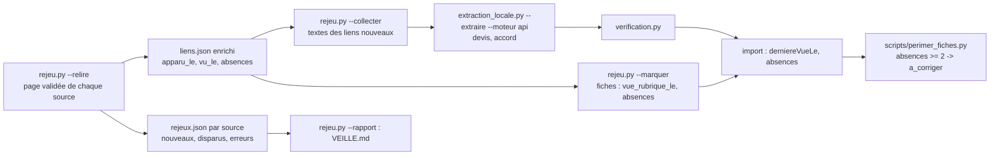

# Design

## Contexte

La découverte (`decouverte.py`) a produit, pour chaque source, `decouverte/<id>/liens.json` : l'adresse de la page
retenue et la liste des liens d'appels (`texte`, `href`, `score`). Les 207 rubriques confirmées ont été relues par
Monsieur DUCOUT ; l'adresse de `liens.json` est donc la page de référence. Le collecteur lit le texte d'un lien une seule
fois (fichier `fiches/<sha>.txt`), l'extraction V4 traite les textes non encore traités. Il manque la relecture
périodique de ces pages et le suivi des liens dans le temps.

## Décisions

1. **Relire la page de `liens.json`, et elle seule** : c'est la page que Monsieur DUCOUT a validée à l'écran. Pas de
   nouvelle recherche de rubrique au rejeu (la découverte reste l'outil pour cela). Même filtre de liens que la
   découverte (`choisir_rubrique` sur une seule page) pour comparer des listes de même nature.
2. **Compteurs sur les liens, pas suppression** : un lien disparu reste dans `liens.json` avec `absences` croissant ;
   on ne perd jamais l'information et une page momentanément vide (erreur, refonte) ne déclenche rien : la règle
   « aucun lien ou erreur = rejeu ignoré pour cette source » protège des fausses disparitions.
3. **Deux rejeux consécutifs** avant péremption, comme le demande le rapport : un oubli ponctuel du site (lien retiré
   puis remis, panne) ne retire pas un appel.
4. **Péremption = « à corriger », pas archivage** : la fiche reste visible avec la mention « Non relue » et sa date de
   dernière vue ; Monsieur DUCOUT tranche (archiver, ou garder si l'appel vit ailleurs). `[À VALIDER — Monsieur
   DUCOUT]` : préférer le retrait automatique de la publication ?
5. **`derniereVueLe` change de sens** : date de dernière vue sur la page source quand le rejeu existe, sinon date de
   l'import (règle de la veille). C'est la date utile au visiteur et à la péremption.
6. **Extraction des textes nouveaux par la commande V4 existante**, pour garder un seul endroit où le devis est écrit
   et accepté avant tout appel payant.
7. **Rythme humain** : une page à la fois, pause de deux secondes, images et polices bloquées, comme la découverte
   (règle réseau du projet : box personnelle, un site à la fois).

## Risques

- Pages à pagination ou chargement différé : seuls les liens de la première page sont vus ; un appel relégué en page 2
  compterait une absence. Limite connue de la découverte, inchangée ; le délai de deux rejeux amortit, et le rapport
  de veille rend les disparitions visibles avant toute péremption.
- Sites qui bloquent le robot (préfectures, ameli) : en erreur au rejeu, donc ignorés, jamais périmés à tort.
