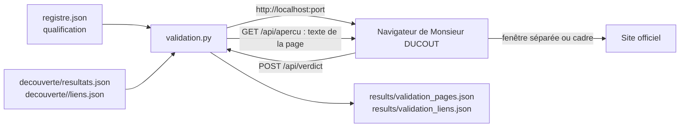

# Design

## Contexte

L'outil existe déjà (`scraping/validation.py`, construit le 2026-10-13 en six retouches hors
OpenSpec). Ce design décrit ce qui est en place, pour que la spec soit rejouée contre le code réel
et que les écarts apparaissent, pas pour reconstruire.

## Flux

## Choix

- **Bibliothèque standard (`http.server`) et `requests` déjà installé** : pas de dépendance nouvelle,
  rien à installer, zéro euro. Un serveur local est nécessaire parce que le verdict doit être écrit
  sur le disque du poste depuis une page web.
- **Une page HTML dans le fichier Python** : un seul fichier à lancer, pas de construction ; le
  volume reste petit (quelques dizaines de lignes de JavaScript).
- **Fenêtre séparée par défaut** : beaucoup de sites publics interdisent leur affichage dans un
  cadre (en-tête `X-Frame-Options`) et le navigateur ne permet pas de le détecter ; Monsieur DUCOUT
  a choisi la fenêtre séparée, qu'il place lui-même. Le choix est gardé dans `localStorage` du
  navigateur, car c'est un confort d'affichage, pas une donnée du projet.
- **Texte de la page lu par le serveur** (`texte_sans_balises` de `qualification.py`, réutilisée)
  : aperçu toujours disponible, même quand le cadre est refusé. Le serveur ne lit que les adresses
  de la liste en cours, pour ne pas servir de relais vers n'importe quel site.
- **Un fichier de verdicts par mode**, clé = adresse : rejouable, lisible, et les trois listes ne se
  mélangent pas. Verdicts écrits à chaque clic (pas à la fin) : rien n'est perdu si la fenêtre est
  fermée.
- **Échantillon à tour de rôle avec graine fixe** : une première passe sur des sources différentes,
  et la même liste à chaque lancement pour que les verdicts restent en face des mêmes liens.
- **Liens cassés écartés** (crochets, accolades, dièse dans l'intitulé) : gabarits non remplis par
  les sites, vus sur la Fondation APICIL.

## Limites connues

- Le mode `--pages` présente la page gardée telle que la découverte l'a retenue ; la correction du
  registre à partir des verdicts est hors périmètre (changement `recherche-page-aap-par-source`).
- Les fichiers (PDF, DOCX) n'ont pas d'aperçu texte ; la fenêtre séparée les affiche ou les
  télécharge selon le navigateur.
- Pas de grille de critères détaillée pour les liens : six boutons seulement, à faire évoluer après
  la première passe de Monsieur DUCOUT.
